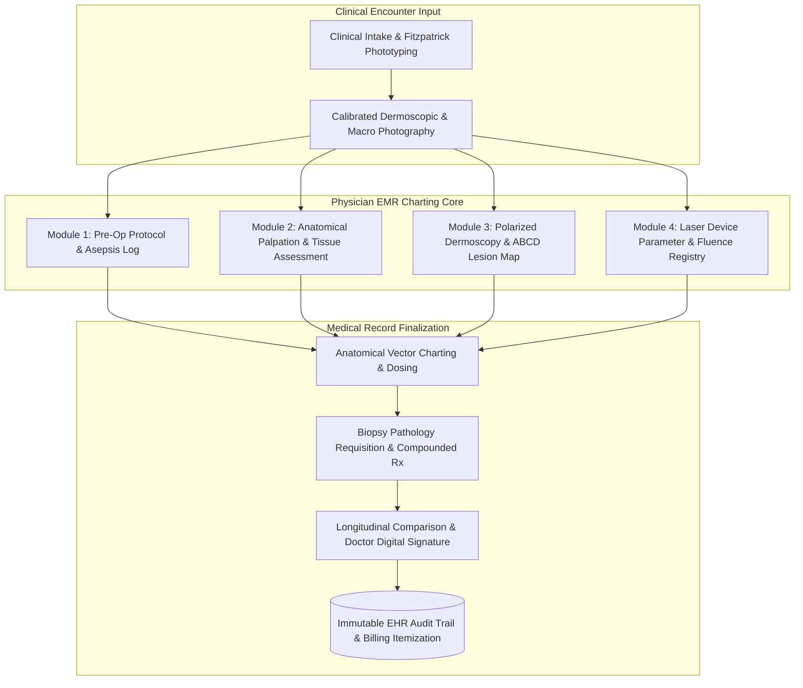
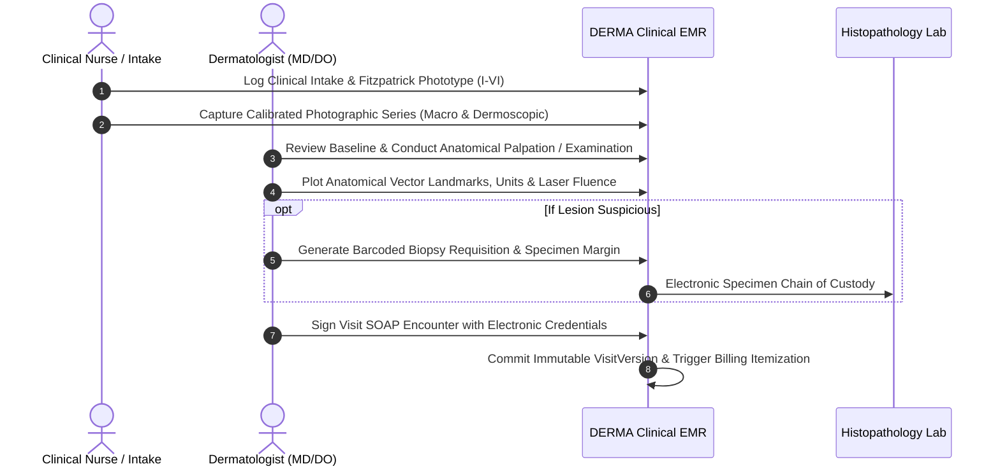

# Comprehensive Plan: Refactoring DERMA into a Physician-Grade Dermatology EMR

> **Document Version**: 2.0  
> **Target Audiences**: Dermatologists (MD/DO), Mohs Micrographic Surgeons, Aesthetic Physicians, Clinical Nurse Practitioners (NP/PA), Clinic Medical Directors & Practice Administrators.  
> **Platforms Affected**: 
> - **DERMA Clinical EMR**: `https://github.com/mhd-shereef/Derma`
> - **MedNexa Portal**: `https://github.com/mhd-shereef/MedNexa`

---

## 1. Executive Summary & Core Paradigm Shift

### The Problem
In recent iterations, the terminology in DERMA's landing page inadvertently adopted language resembling a **consumer aesthetic salon or medical spa treatment menu** (e.g., *"Procedure 01: Clinical Facial Cleansing"*, *"Procedure 02: Facial Sculpting & Massage"*, *"Aesthetic Rejuvenation"*, *"Patient Journey"*).

A practicing dermatologist or clinic director evaluating software does **not** evaluate software based on whether they can purchase a facial cleansing or a massage. They evaluate software based on:
1. **Clinical Encounter Efficiency**: Can the doctor document SOAP notes and sign off within 90 seconds?
2. **Visual Anatomical Charting**: Can the physician map neuromodulator units, dermal filler depths, and laser passes directly onto vector facial landmarks?
3. **Dermoscopic Lesion Surveillance**: Does it support standardized high-magnification cross-polarized photography with body-region tagging and longitudinal comparison sliders?
4. **Diagnostic & Pathologic Integrity**: Can biopsy requisitions be barcoded and tied directly to the anatomical site in the patient record?
5. **Regulatory & Malpractice Defense**: Does the system maintain an immutable, tamper-evident audit log of every chart edit, photo view, and signature version?

### The Solution: 100% Physician-Oriented EMR Architecture
Every piece of copy, every workflow diagram, and all real clinical photography will be reframed as **Specialized Physician Charting & Documentation Modules** within the DERMA Clinical OS.

---

## 2. Section-by-Section Transformation Specifications

### Section 1: Floating Navigation Bar
- **Current Center Links**: `Overview` • `Clinical Solutions` • `Photo Records` • `Practice Flow` • `Specialties`
- **New Physician Links**:
  - `Overview` $\rightarrow$ Practice Overview
  - `Clinical Solutions` $\rightarrow$ EMR Capabilities
  - `Photo Records` $\rightarrow$ Dermoscopic Imaging
  - `Practice Flow` $\rightarrow$ Encounter Workflow
  - `Specialties` $\rightarrow$ **Clinical Modules**

---

### Section 2: Hero Section & Clinical Trust Bar
- **Eyebrow Tag**:
  - *Current*: `Clinical Dermatology & Practice Management`
  - *New*: `Electronic Medical Records (EMR) & Dermatology Clinical OS`
- **Main Headline**:
  - *Current*: `Precision Clinical Care for Modern Dermatology`
  - *New*: `The Purpose-Built EMR for Dermatologists & Clinical Practices`
- **Subtitle**:
  - *Current*: Generic overview mentioning everyday clinical appointments.
  - *New*:
    > *"Generic EHRs force dermatologists into rigid, unstructured text boxes. DERMA provides structured clinical documentation engineered specifically for medical, surgical, and aesthetic dermatology: visual anatomical vector charting, calibrated dermoscopic photo surveillance, laser parameter registries, and biopsy chain-of-custody tracking in a single HIPAA-compliant workspace."*
- **Clinical Trust Bar**:
  - *Item 1*: `Standardized Photographic Projection Grids`
  - *Item 2*: `Anatomical Vector Landmarks & Dosage Tracking`
  - *Item 3*: `Barcoded Biopsy Custody & Histopathology Linking`
  - *Item 4*: `Immutable 21 CFR Part 11 Electronic Sign-Off`

---

### Section 3: Practice Health Dashboard (Interactive Preview)
- **Header**: `Practice Health Dashboard: Daily Consultation & Clinical Encounter Overview`
- **Sub-caption**: `Live clinical operational snapshot for Saint Jude Dermatology & Dermatologic Surgery`
- **Switcher Tabs**: `Encounters & Consultations` • `Anatomical Charting` • `Photo Surveillance`
- **Vital Metric Cards**:
  1. **Encounter Queue**: `28 Scheduled Encounters` *(+4 surgical / punch biopsies today)*
  2. **Documented Interventions**: `14 Clinical Protocols Signed` *(9 injectable vector charts • 5 laser logs)*
  3. **Pathology Chain of Custody**: `6 Biopsy Specimens` *(Histopathology transport in progress)*
  4. **Clinical Throughput**: `94% On-Schedule Flow` *(Average physician intake-to-charting: 6.8 min)*
- **Physician Clinical Reminders**:
  - `Dermoscopic Surveillance`: 4 patients due for 6-month longitudinal digital surveillance of dysplastic nevi.
  - `Laser Endpoint Tolerability`: Day 3 post-procedure erythema clearance confirmed on all pulsed dye laser follow-ups.
  - `Compounded Rx Adherence`: 92% portal compliance on customized tretinoin / hydroquinone compounding regimens.

---

### Section 4: Core Clinical EMR Capabilities (The 6 Pillars)
Refined to address the specific documentation burdens dermatologists face:

1. **Standardized Dermoscopic & Macro Photographic Mapping**:
   - Fixed anatomical projection angles (anterior, lateral, oblique) with calibrated ambient lighting guidance.
   - Body region and sub-region tagging (`forehead`, `periorbital`, `nasolabial`, `malar`) linked to patient timelines.
2. **Interactive Anatomical Vector Charting**:
   - Point-and-click facial and body vector templates.
   - Log exact consumable units (Botox/Dysport), needle gauges, injection planes (subcutaneous, periosteal), and dilution ratios.
3. **Biopsy Chain of Custody & Histopathology Integration**:
   - Electronic lab requisition generation with barcode specimen custody.
   - Anatomical margin tracking (Mohs stage mapping, punch excision depths) with automated pathology report linking.
4. **Compounded Dermatological Formulations & Taper Schedules**:
   - Pre-configured dermatologic compounding formulas (triple-combination creams, customized keratolytics).
   - Structured topical corticosteroid step-down schedules with automated contraindication warnings.
5. **Multi-Provider Clinical Queue & Treatment Room Orchestration**:
   - Live room occupancy tracking across dermatologists, laser nurses, and physician assistants.
   - Fast handoff protocols between clinical intake staff and attending physicians.
6. **Regulatory Security & Immutable Audit Trail**:
   - Role-based clinical boundaries (Doctor, Nurse, Receptionist, Owner).
   - Tamper-evident logging of every medical chart view, photo download, and electronic amendment.

---

### Section 5: Clinical Encounter Workflow (Replaces "Patient Journey")
Reframe the workflow from a customer booking experience into a **Physician Clinical Encounter Life Cycle**:

- **Step 01: Clinical Triage & Fitzpatrick Classification**:
  - Medical history intake, dermatological allergy flagging, Fitzpatrick phototyping (I–VI), and previous cosmetic/laser exposure records.
- **Step 02: Calibrated Clinical & Dermoscopic Capture**:
  - Standardized positioning guidance, polarized dermoscopic lesion inspection, and cross-session baseline image logging.
- **Step 03: Anatomical Vector Charting & Dosing**:
  - Attending physician plots injection landmarks, device fluence parameters ($J/cm^2$), spot sizes, and surgical margins directly onto anatomical vector charts.
- **Step 04: Longitudinal Outcome Tracking & EHR Sign-Off**:
  - Split-screen comparison sliders compare baseline and post-treatment images to evaluate therapeutic response before signing the visit record.

---

### Section 6: Clinical Environment & Photography Showcase
- **Headline**: `Engineered for Clinical Environments of Every Scale`
- **Copy Focus**:
  - Workstation, tablet, and mobile device synchronization in sterile procedure rooms.
  - Secure Physician Review of Patient Follow-Up Images: Patients submit follow-up recovery photos through an encrypted portal directly into the physician's clinical review queue, eliminating unencrypted email/messaging liabilities.
  - Multi-Provider Billing: Automated procedure code capture (CPT/dermatology codes) linked to signed encounter notes.

---

### Section 7: Specialized Clinical Charting Modules (The 4 Real Procedure Photos)
This is the core section that previously read like a spa service menu. It will be completely converted into **Physician Clinical Charting Modules**:

#### Module 1: Pre-Operative Preparation & Skin Protocol Charting
- **Image**: [`/facial-cleansing.jpg`](file:///c:/Users/moham/DERMA-ai/frontend/public/facial-cleansing.jpg)
- **Module ID**: `Clinical Module 01`
- **Clinical Category**: `Pre-Operative Asepsis & Protocol`
- **Display Title**: `Pre-Operative Skin Protocol & Asepsis Charting`
- **Physician Objective**: Documenting antiseptic preparation, skin barrier baseline, and protocol clearance prior to peels, minor surgical excisions, or laser interventions.
- **EMR Clinical Fields Documented**:
  - Antiseptic agent logged (Chlorhexidine / Isopropyl / Povidone-iodine).
  - Skin barrier assessment (erythema, barrier disruption grade).
  - Follicle preparation & degreasing protocol sign-off.
  - Fitzpatrick phototype verification against treatment parameters.
- **EMR Tags**: `Antiseptic Protocol` • `Fitzpatrick Phototype` • `Barrier Grade` • `Pre-Op Sign-off`
- **Discipline Badge**: `Medical Dermatology`

#### Module 2: Anatomical Palpation & Soft-Tissue Assessment
- **Image**: [`/facial-massage.jpg`](file:///c:/Users/moham/DERMA-ai/frontend/public/facial-massage.jpg)
- **Module ID**: `Clinical Module 02`
- **Clinical Category**: `Aesthetic & Structural Examination`
- **Display Title**: `Anatomical Palpation & Soft-Tissue Assessment`
- **Physician Objective**: Enabling aesthetic dermatologists and proceduralists to document physical palpation, SMAS tissue laxity, volume deficits, and post-injection product placement.
- **EMR Clinical Fields Documented**:
  - Subcutaneous fat pad assessment (malar, temple, submental).
  - Dynamic vs. static rhytid grading (Glogau score).
  - Post-injection soft-tissue integration & vascular refill check.
  - Post-procedural edema grade (0 to 3) and lymphatic drainage monitoring.
- **EMR Tags**: `Tissue Palpation` • `Vector Coordinates` • `Edema Grade 0-3` • `Vascular Refill Log`
- **Discipline Badge**: `Aesthetic & Procedural Medicine`

#### Module 3: Polarized Dermoscopy & Lesion Surveillance Log
- **Image**: [`/face-testing.jpg`](file:///c:/Users/moham/DERMA-ai/frontend/public/face-testing.jpg)
- **Module ID**: `Clinical Module 03`
- **Clinical Category**: `Diagnostic Dermatology & Oncology`
- **Display Title**: `Polarized Dermoscopy & Lesion Surveillance Log`
- **Physician Objective**: High-resolution digital dermoscopic documentation for pigmented and non-pigmented skin lesions, atypical nevi surveillance, and melanoma triage.
- **EMR Clinical Fields Documented**:
  - Handheld dermoscopy magnification & polarized lighting mode.
  - ABCD rule evaluation (Asymmetry, Border, Color, Diameter).
  - Dermal pigment depth & vascular pattern classification.
  - Anatomical body-map pin linked to automated biopsy requisition.
- **EMR Tags**: `ABCD Melanoma Index` • `Dermoscopic Grid` • `Body Map Tag` • `Specimen Biopsy Link`
- **Discipline Badge**: `Diagnostic Dermatology`

#### Module 4: Energy-Based Device & Laser Parameter Documentation
- **Image**: [`/laser-rejuvenation.jpg`](file:///c:/Users/moham/DERMA-ai/frontend/public/laser-rejuvenation.jpg)
- **Module ID**: `Clinical Module 04`
- **Clinical Category**: `Laser & Energy Device Registry`
- **Display Title**: `Energy-Based Device & Laser Parameter Registry`
- **Physician Objective**: Structured logging of laser surgical settings to ensure reproducibility, audit compliance, and safety across multi-provider clinics.
- **EMR Clinical Fields Documented**:
  - Laser wavelength (e.g. 532 nm, 755 nm, 1064 nm, 2940 nm).
  - Pulse fluence ($J/cm^2$), pulse duration (ms/ns/ps), spot size (mm).
  - Total pulse count and pass density.
  - Immediate clinical endpoint observed (perilesional erythema, follicular edema, immediate whitening).
- **EMR Tags**: `Fluence (J/cm²)` • `Spot Size & Pulses` • `Endpoint Reaction` • `Safety Lockouts`
- **Discipline Badge**: `Energy-Based Therapeutics`

---

### Section 8: Call-to-Action & Practice Readiness
- **Eyebrow**: `Clinical Onboarding`
- **Title**: `Ready to Equip Your Practice with a Dedicated Dermatology EMR?`
- **Subtitle**: `Experience a live clinical workspace configured with real patient records, anatomical charting templates, and dermoscopy workflows.`
- **CTA**: `Launch Practitioner DEMO` *(auto-loads Dr. Arjun Patel clinical workspace)*.

---

### Section 9: Professional Clinical Footer
- **Company Description**:
  > *"DERMA is an enterprise electronic medical records (EMR) and clinical operating system engineered exclusively for medical, surgical, and aesthetic dermatology practices worldwide."*
- **Directory Links**:
  - *Clinical Platform*: Patient Charting, Photographic Surveillance, Anatomical Vector Maps, Biopsy Custody, Compounded Formulations, Clinical Queue.
  - *Clinical Modules*: Pre-Op Skin Protocols, Tissue Palpation Logs, Polarized Dermoscopy, Laser & Energy Registry, Mohs Surgical Notes.
  - *Governance & Compliance*: HIPAA Security Safeguards, 21 CFR Part 11 Electronic Signatures, Immutable Audit Trails, Role-Based Access Controls.

---

## 3. Database Schema & Data Model Alignment

Every proposed frontend change directly reflects the existing PostgreSQL / Prisma backend schema:

| Frontend EMR Module | Backend Prisma Models & Fields |
| :--- | :--- |
| **Pre-Op & Encounter Charting** | `Visit` (`soapNotes`, `status`), `Patient` (`allergies`, `medicalHistory`, `bloodGroup`) |
| **Anatomical Vector Charting** | `ProcedureNote` (`bodyArea`, `settings` JSON, `performedBy`), `ProcedureTemplate` |
| **Dermoscopic Photo Surveillance** | `Photo` (`bodyRegion`, `bodySubRegion`, `annotations` JSON), `PhotoAccessLog` |
| **Laser Parameter Registry** | `ProcedureTemplate` (`category = LASER`, `fieldsSchema`), `ProcedureNote` (`settings`) |
| **Biopsy Chain of Custody** | `ProcedureTemplate` (`category = SURGICAL`), `VisitVersion` (`snapshot`) |
| **Topical Compounding Rx** | `Prescription`, `PrescriptionItem`, `Regimen` |
| **Audit Logs & Sign-Off** | `AuditLog` (`action`, `entityType`, `ipAddress`), `Visit.signedBy`, `Visit.signedAt` |

---

## 4. MedNexa Cross-Platform Synchronization Plan

In `scratch\mednexa-repo\src\app\page.tsx`:
1. **DERMA Product Card Subtitle**:
   - Change from generic salon/software summary to: *"The specialized EMR for medical, surgical, and aesthetic dermatology: standardized photographic mapping, facial vector charting, laser device parameter logs, and multi-provider encounter management."*
2. **Thumbnail Procedural Strip**:
   - Update label from `Specialized Procedures` to **`Clinical EMR Modules`**.
   - Update the 4 miniature badges to match the clinical charting modules:
     - `Pre-Op Protocol`
     - `Tissue Exam`
     - `Dermoscopy`
     - `Laser Logs`

---

## 5. Execution Steps & Verification Milestones

1. **Phase 1: DERMA Landing Page Refactoring**
   - Update `frontend/src/app/page.tsx` with all physician-oriented copy, headers, and metadata.
   - Replace Section 7 cards with the 4 Physician Clinical Charting Modules.
   - Update Section 5 with the 4-step Physician Encounter Life Cycle.
2. **Phase 2: MedNexa Ecosystem Synchronization**
   - Update `scratch\mednexa-repo\src\app\page.tsx` DERMA card copy and thumbnail badges.
3. **Phase 3: Production Build Validation**
   - Execute `npm run build` in both `frontend` and `mednexa-repo` to verify zero TypeScript errors, valid component trees, and zero lint breaks.
4. **Phase 4: Git Commit & Remote Push**
   - Stage, commit, and push both repositories to GitHub:
     - `mhd-shereef/Derma`
     - `mhd-shereef/MedNexa`
