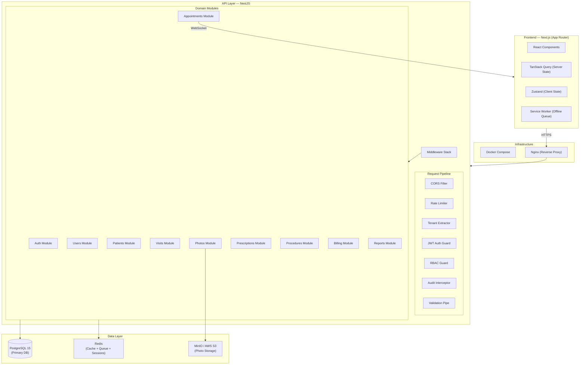
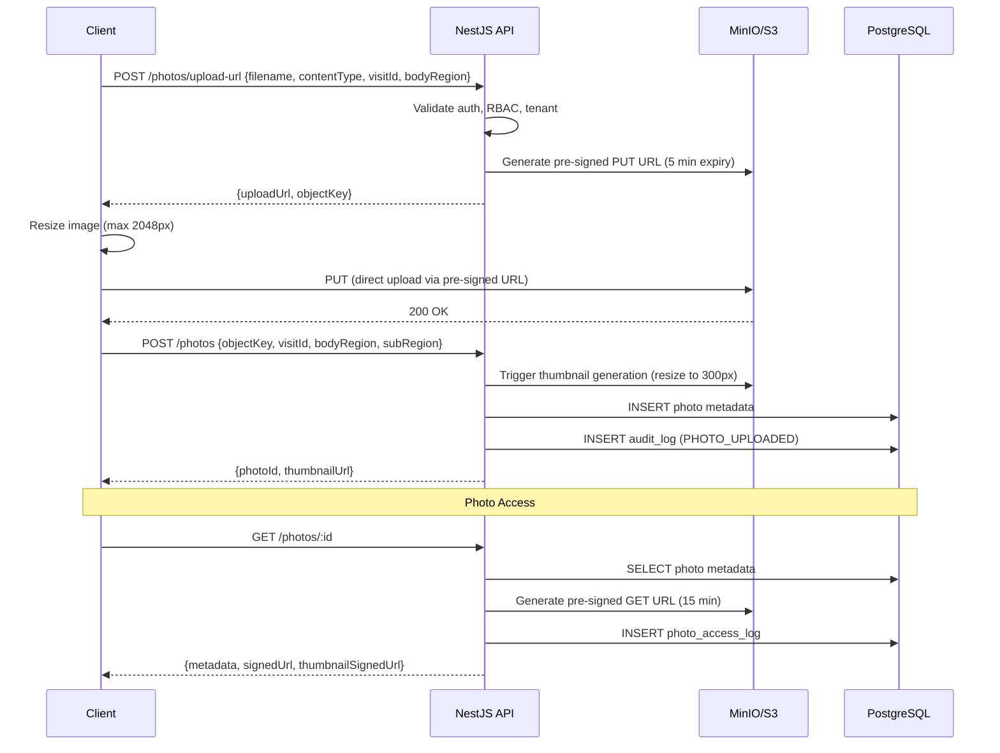
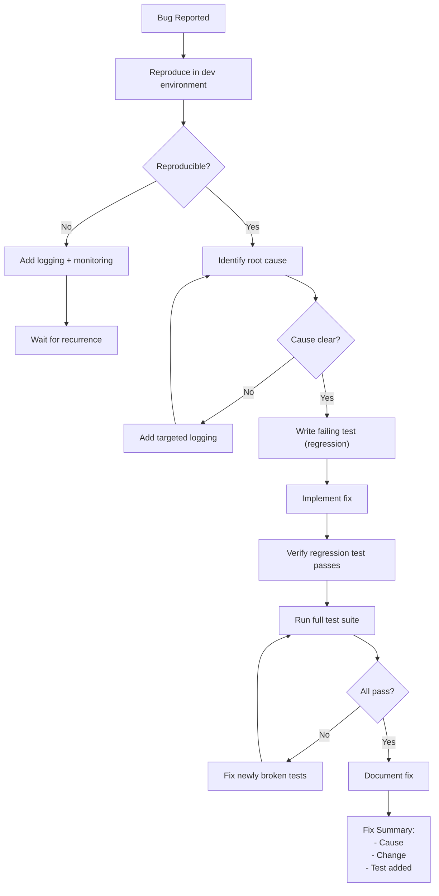
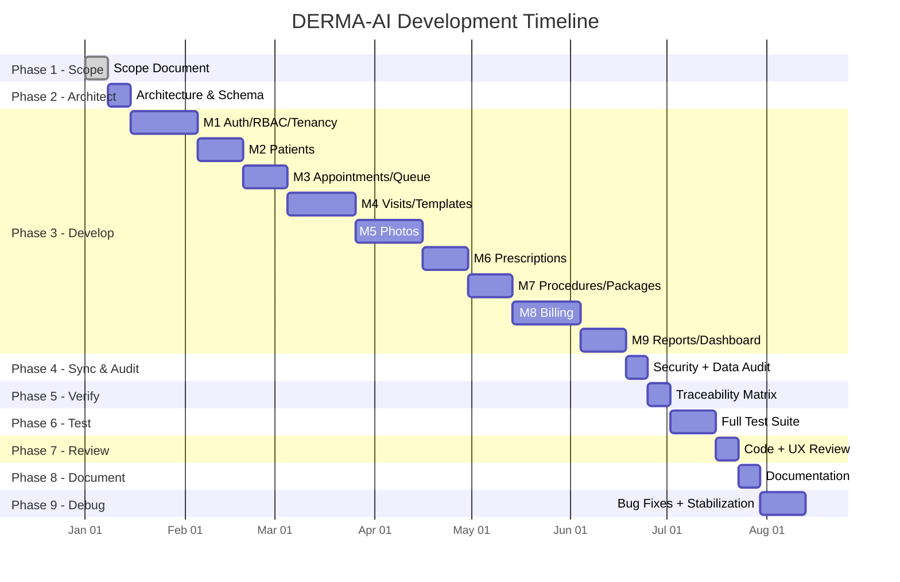

# DERMA-AI — Full Implementation Plan (All 9 Phases)

> **Aesthetic Dermatology EMR** · India Market · SaaS · Multi-Tenant
> Tech: NestJS · Next.js · PostgreSQL · Prisma · MinIO/S3 · Docker

---

# Phase 1 — SCOPE

## 1.1 Product Restatement

A cloud-based, multi-tenant EMR designed exclusively for **aesthetic dermatology clinics in India**. The system manages the complete patient journey — from registration and appointment booking through consultation, photo documentation, procedure execution, prescription, and billing. Built as SaaS with row-level tenant isolation, targeting small and mid-size clinics.

## 1.2 Users & Top Workflows

| Role                         | Top 3 Workflows                                                                                      |
| ---------------------------- | ---------------------------------------------------------------------------------------------------- |
| **Doctor**             | 1. Open visit → review history & photos → record procedure notes → write prescription → sign off |
|                              | 2. Compare before/after photos across visits                                                         |
|                              | 3. Review daily schedule and patient queue                                                           |
| **Nurse / Technician** | 1. Prep patient → record vitals/observations → upload photos                                       |
|                              | 2. Assist with procedure → document consumables used                                                |
|                              | 3. Print post-procedure care instructions                                                            |
| **Receptionist**       | 1. Register new patient (with duplicate check) → book appointment                                   |
|                              | 2. Check-in patient → manage queue                                                                  |
|                              | 3. Generate invoice → collect payment → print receipt                                              |
| **Clinic Admin**       | 1. Configure procedure templates, packages, and pricing                                              |
|                              | 2. Manage staff accounts and role permissions                                                        |
|                              | 3. Review daily/monthly reports                                                                      |
| **Owner**              | 1. View revenue dashboards across doctors/time periods                                               |
|                              | 2. Analyze procedure popularity and patient retention                                                |
|                              | 3. Manage clinic settings and subscription                                                           |

## 1.3 MVP vs. Post-MVP

### ✅ MVP Modules

| ID | Module                                      |
| -- | ------------------------------------------- |
| M1 | Auth / RBAC / Multi-Tenancy / Audit Logging |
| M2 | Patient Registration & Search               |
| M3 | Appointments & Queue Management             |
| M4 | Visits, Templates & Procedure Notes         |
| M5 | Clinical Photo Management                   |
| M6 | Prescriptions & Regimens                    |
| M7 | Procedures & Session Packages               |
| M8 | Billing, Invoicing & Payments               |
| M9 | Reports & Dashboard                         |

### 🔜 Post-MVP

- Body map with lesion annotation
- Severity scores (PASI, EASI, IGA, DLQI, SALT)
- Digital consent forms with e-signature
- Biopsy tracking & lab orders
- Inventory management (injectables, consumables)
- Patient self-service portal
- WhatsApp/SMS reminders
- Insurance & TPA integration
- Marketing consent gallery
- Multi-location support
- Advanced analytics

### 🚫 Out of Scope (v1)

- Diagnostic AI
- Telemedicine / video calls
- External EHR/HIS integration
- Native mobile app (responsive web only)
- Pharmacy/inventory management
- Insurance claim processing

## 1.4 User Stories & Acceptance Criteria

### M1 — Auth / RBAC / Tenancy / Audit

| ID    | Story                                                           | Acceptance Criteria                                                                                                                                                     |
| ----- | --------------------------------------------------------------- | ----------------------------------------------------------------------------------------------------------------------------------------------------------------------- |
| M1-01 | As a user, I can log in with email and password                 | ✓ JWT access token (15 min) + refresh token (7 days) issued · ✓ Invalid credentials return 401 · ✓ Account locks after 5 failed attempts for 15 min                |
| M1-02 | As a user, I can refresh my session without re-logging in       | ✓ Refresh token endpoint issues new access token · ✓ Expired refresh token returns 401 · ✓ Used refresh tokens are rotated (one-time use)                          |
| M1-03 | As an admin, I can create staff accounts with specific roles    | ✓ Roles: doctor, nurse, receptionist, admin, owner · ✓ Each role has a predefined permission set · ✓ New user receives invite email with password setup link       |
| M1-04 | As a user, I can only access data within my own clinic (tenant) | ✓ All queries are automatically scoped by `tenant_id` · ✓ Cross-tenant data access returns 403 · ✓ JWT contains `tenant_id` claim                              |
| M1-05 | As an admin, I can view the audit log                           | ✓ Every create/update/delete on patient data is logged · ✓ Log entries show: who, what, when, IP, old value, new value · ✓ Audit log is immutable (no edit/delete) |
| M1-06 | As a user, my session times out after inactivity                | ✓ 15-min inactivity timeout · ✓ User is redirected to login · ✓ Unsaved work warning shown                                                                         |

### M2 — Patient Registration

| ID    | Story                                                         | Acceptance Criteria                                                                                                                                                   |
| ----- | ------------------------------------------------------------- | --------------------------------------------------------------------------------------------------------------------------------------------------------------------- |
| M2-01 | As a receptionist, I can register a new patient               | ✓ Fields: name, DOB, gender, phone, email, address, emergency contact · ✓ Patient ID auto-generated · ✓ Created timestamp and `created_by` recorded            |
| M2-02 | As a receptionist, I see a duplicate warning when registering | ✓ Fuzzy match on name + phone + DOB · ✓ Warning shown with matching patient cards · ✓ User can proceed (new) or select existing patient                          |
| M2-03 | As a doctor, I can view and edit patient medical history      | ✓ Allergies, chronic conditions, past surgeries, current medications · ✓ Edit creates a new version (old version preserved) · ✓ History changes are audit-logged |
| M2-04 | As any user, I can search patients by name, phone, or ID      | ✓ Search returns results within 500ms · ✓ Results scoped to current tenant · ✓ Minimum 2 characters to trigger search                                            |

### M3 — Appointments & Queue

| ID    | Story                                                        | Acceptance Criteria                                                                                                                          |
| ----- | ------------------------------------------------------------ | -------------------------------------------------------------------------------------------------------------------------------------------- |
| M3-01 | As a receptionist, I can book an appointment                 | ✓ Select patient, doctor, date, time slot, procedure type · ✓ Double-booking prevention · ✓ Confirmation displayed with appointment ID  |
| M3-02 | As a receptionist, I can check in a patient                  | ✓ Status changes from `booked` → `checked_in` · ✓ Patient appears on the queue board · ✓ Arrival time recorded                     |
| M3-03 | As a doctor, I can see my real-time queue                    | ✓ Live queue board updates via WebSocket · ✓ Shows patient name, procedure type, wait time · ✓ Doctor can reorder or skip patients      |
| M3-04 | As a receptionist, I can reschedule or cancel an appointment | ✓ Rescheduled appointments keep original booking reference · ✓ Cancelled appointments are soft-deleted · ✓ Cancellation reason recorded |
| M3-05 | As any user, I can view the appointment calendar             | ✓ Day / week / month views · ✓ Color-coded by status (booked, checked-in, in-progress, completed, cancelled) · ✓ Filterable by doctor   |

### M4 — Visits & Templates

| ID    | Story                                             | Acceptance Criteria                                                                                                                                                                                                                    |
| ----- | ------------------------------------------------- | -------------------------------------------------------------------------------------------------------------------------------------------------------------------------------------------------------------------------------------- |
| M4-01 | As a doctor, I can start a visit from the queue   | ✓ Visit created with status `in_progress` · ✓ Linked to patient and appointment · ✓ Previous visits and photos visible in sidebar                                                                                               |
| M4-02 | As a doctor, I can use procedure templates        | ✓ Templates available: laser (CO2, fractional, Q-switch), chemical peels, PRP, botox, fillers, microneedling · ✓ Each template has predefined fields (area, settings, units, technique) · ✓ Templates are customizable per clinic |
| M4-03 | As a doctor, I can write free-text clinical notes | ✓ Rich text editor with formatting · ✓ Auto-save every 30 seconds · ✓ Notes versioned on each save                                                                                                                                |
| M4-04 | As a doctor, I can complete and sign off a visit  | ✓ Status changes to `completed` · ✓ Visit becomes read-only after sign-off · ✓ Amendments possible with addendum (original preserved)                                                                                           |
| M4-05 | As a doctor, I can select ICD-10 diagnosis codes  | ✓ Searchable ICD-10 code lookup · ✓ Multiple diagnoses per visit · ✓ Most-used codes appear as suggestions                                                                                                                        |

### M5 — Clinical Photos

| ID    | Story                                          | Acceptance Criteria                                                                                                                                                                   |
| ----- | ---------------------------------------------- | ------------------------------------------------------------------------------------------------------------------------------------------------------------------------------------- |
| M5-01 | As a nurse, I can upload photos during a visit | ✓ Multiple photos per upload · ✓ Client-side compression (max 2048px) · ✓ Tagged with body region, visit, date                                                                   |
| M5-02 | As a doctor, I can compare before/after photos | ✓ Side-by-side viewer · ✓ Filter by body region · ✓ Date slider to scroll through visit timeline                                                                                 |
| M5-03 | As a system, photos are stored securely        | ✓ Private bucket, no public URL · ✓ Access via signed URL (15-min expiry) · ✓ Every photo access logged in audit trail                                                           |
| M5-04 | As a doctor, I can annotate photos             | ✓ Draw circles, arrows, text on photo · ✓ Annotations saved as overlay (original preserved) · ✓ Annotated version viewable in visit record                                       |
| M5-05 | As a nurse, I can tag photos with body region  | ✓ Predefined regions: face, neck, scalp, chest, back, arms, legs, hands, feet · ✓ Sub-regions for face: forehead, cheeks, chin, nose, periorbital · ✓ Tags filterable in gallery |

### M6 — Prescriptions

| ID    | Story                                              | Acceptance Criteria                                                                                                                             |
| ----- | -------------------------------------------------- | ----------------------------------------------------------------------------------------------------------------------------------------------- |
| M6-01 | As a doctor, I can create a prescription           | ✓ Drug name, dosage, frequency, duration, route, instructions · ✓ Linked to visit · ✓ Multiple drugs per prescription                      |
| M6-02 | As a doctor, I can use reusable regimens           | ✓ Save a set of drugs as a named regimen (e.g., "Post-laser care") · ✓ One-click apply regimen to prescription · ✓ Editable after applying |
| M6-03 | As a receptionist, I can print a prescription      | ✓ Branded printout with clinic logo, doctor name, license number · ✓ Patient name, age, date · ✓ Clear drug table with instructions        |
| M6-04 | As a doctor, I can add post-procedure instructions | ✓ Predefined instruction templates per procedure type · ✓ Customizable per patient · ✓ Printable separately or with Rx                     |

### M7 — Procedures & Packages

| ID    | Story                                                       | Acceptance Criteria                                                                                                                                                                               |
| ----- | ----------------------------------------------------------- | ------------------------------------------------------------------------------------------------------------------------------------------------------------------------------------------------- |
| M7-01 | As an admin, I can create procedure catalog entries         | ✓ Name, category, default price, duration, description · ✓ Active/inactive toggle · ✓ Categorized (laser, injectable, topical, etc.)                                                         |
| M7-02 | As an admin, I can create session packages                  | ✓ Package: name, procedure, number of sessions, total price, validity period · ✓ Example: "6× Laser Hair Removal — ₹30,000 — valid 12 months" · ✓ Discount vs individual pricing visible |
| M7-03 | As a receptionist, I can sell a package to a patient        | ✓ Package linked to patient record · ✓ Sessions remaining tracked · ✓ Expiry date calculated from purchase date                                                                              |
| M7-04 | As a doctor, I can consume a package session during a visit | ✓ Available packages shown when starting a visit · ✓ Session count decremented · ✓ Warning when 1 session remaining · ✓ Block usage after expiry                                           |
| M7-05 | As a receptionist, I can view package utilization           | ✓ All active packages for a patient listed · ✓ Sessions used vs remaining · ✓ Expiry date and status (active, expired, completed)                                                            |

### M8 — Billing

| ID    | Story                                                     | Acceptance Criteria                                                                                                                                                       |
| ----- | --------------------------------------------------------- | ------------------------------------------------------------------------------------------------------------------------------------------------------------------------- |
| M8-01 | As a receptionist, I can generate an invoice from a visit | ✓ Auto-populated from visit procedures · ✓ Line items editable (add, remove, adjust price) · ✓ Package sessions deducted automatically (no charge for covered items) |
| M8-02 | As a receptionist, I can apply discounts                  | ✓ Percentage or fixed amount · ✓ Discount reason required · ✓ Discount approved by admin (configurable)                                                              |
| M8-03 | As a system, I calculate GST correctly                    | ✓ CGST + SGST (intra-state) or IGST (inter-state) · ✓ Tax rate configurable per service (default 18% for healthcare services) · ✓ HSN/SAC codes on invoice           |
| M8-04 | As a receptionist, I can record payments                  | ✓ Payment modes: cash, card, UPI, bank transfer · ✓ Partial payments supported · ✓ Outstanding balance tracked                                                       |
| M8-05 | As a receptionist, I can print a receipt/invoice          | ✓ GST-compliant invoice format · ✓ Clinic GSTIN, patient details, line items, tax breakdown · ✓ Unique invoice number (sequential per financial year)                |
| M8-06 | As a patient, I receive a billing summary                 | ✓ Printable / email-able summary · ✓ Includes all visits, procedures, payments, outstanding balance                                                                    |

### M9 — Reports & Dashboard

| ID    | Story                                             | Acceptance Criteria                                                                                                                      |
| ----- | ------------------------------------------------- | ---------------------------------------------------------------------------------------------------------------------------------------- |
| M9-01 | As an owner, I can view a revenue dashboard       | ✓ Total revenue (daily, weekly, monthly, custom range) · ✓ Revenue by doctor, by procedure type · ✓ Comparison with previous period |
| M9-02 | As an admin, I can view a daily collection report | ✓ All payments received today · ✓ Breakdown by payment mode · ✓ Outstanding amounts                                                 |
| M9-03 | As an admin, I can view patient volume metrics    | ✓ New patients vs returning · ✓ Appointments vs walk-ins · ✓ No-show rate                                                           |
| M9-04 | As an owner, I can view procedure analytics       | ✓ Most popular procedures · ✓ Package utilization rate · ✓ Revenue per procedure type                                               |
| M9-05 | As an admin, I can export reports                 | ✓ Export to PDF and Excel · ✓ Date range filter · ✓ Auto-generated filename with date                                               |

---

# Phase 2 — ARCHITECT

## 2.1 System Architecture



## 2.2 Database Schema

### Tenant & Auth

```sql
-- Tenant (Clinic)
tenant
  id              UUID PK DEFAULT gen_random_uuid()
  name            VARCHAR(255) NOT NULL
  slug            VARCHAR(100) UNIQUE NOT NULL
  gstin           VARCHAR(15)
  address         JSONB
  phone           VARCHAR(20)
  email           VARCHAR(255)
  logo_url        TEXT
  settings        JSONB DEFAULT '{}'
  subscription_status  ENUM('trial','active','suspended','cancelled')
  created_at      TIMESTAMPTZ DEFAULT NOW()
  updated_at      TIMESTAMPTZ DEFAULT NOW()
  deleted_at      TIMESTAMPTZ

-- User (Staff)
user
  id              UUID PK DEFAULT gen_random_uuid()
  tenant_id       UUID FK -> tenant.id NOT NULL
  email           VARCHAR(255) NOT NULL
  password_hash   VARCHAR(255) NOT NULL
  first_name      VARCHAR(100) NOT NULL
  last_name       VARCHAR(100) NOT NULL
  role            ENUM('owner','admin','doctor','nurse','receptionist') NOT NULL
  phone           VARCHAR(20)
  license_number  VARCHAR(50)       -- for doctors
  specialization  VARCHAR(100)      -- for doctors
  is_active       BOOLEAN DEFAULT TRUE
  mfa_secret      VARCHAR(255)      -- TOTP secret
  mfa_enabled     BOOLEAN DEFAULT FALSE
  failed_login_attempts  INT DEFAULT 0
  locked_until    TIMESTAMPTZ
  last_login_at   TIMESTAMPTZ
  created_at      TIMESTAMPTZ DEFAULT NOW()
  updated_at      TIMESTAMPTZ DEFAULT NOW()
  deleted_at      TIMESTAMPTZ
  UNIQUE(tenant_id, email)

-- Refresh Token
refresh_token
  id              UUID PK
  user_id         UUID FK -> user.id NOT NULL
  token_hash      VARCHAR(255) NOT NULL
  device_info     JSONB
  expires_at      TIMESTAMPTZ NOT NULL
  revoked_at      TIMESTAMPTZ
  created_at      TIMESTAMPTZ DEFAULT NOW()

-- Audit Log (Immutable)
audit_log
  id              BIGSERIAL PK
  tenant_id       UUID NOT NULL
  user_id         UUID
  action          ENUM('CREATE','READ','UPDATE','DELETE','LOGIN','LOGOUT','EXPORT') NOT NULL
  entity_type     VARCHAR(100) NOT NULL
  entity_id       UUID
  old_value       JSONB
  new_value       JSONB
  ip_address      INET
  user_agent      TEXT
  metadata        JSONB
  created_at      TIMESTAMPTZ DEFAULT NOW()
  -- NO updated_at, NO deleted_at — immutable
```

### Patients

```sql
patient
  id              UUID PK DEFAULT gen_random_uuid()
  tenant_id       UUID FK -> tenant.id NOT NULL
  patient_number  VARCHAR(20) NOT NULL        -- clinic-scoped sequential
  first_name      VARCHAR(100) NOT NULL
  last_name       VARCHAR(100) NOT NULL
  date_of_birth   DATE
  gender          ENUM('male','female','other','prefer_not_to_say')
  phone           VARCHAR(20) NOT NULL
  email           VARCHAR(255)
  address         JSONB
  emergency_contact  JSONB                    -- {name, phone, relation}
  blood_group     VARCHAR(5)
  allergies       TEXT[]
  medical_history JSONB                       -- chronic conditions, surgeries, medications
  notes           TEXT
  profile_photo_key  VARCHAR(500)
  created_by      UUID FK -> user.id
  created_at      TIMESTAMPTZ DEFAULT NOW()
  updated_at      TIMESTAMPTZ DEFAULT NOW()
  deleted_at      TIMESTAMPTZ
  UNIQUE(tenant_id, patient_number)
  INDEX(tenant_id, phone)
  INDEX(tenant_id, last_name, first_name)
```

### Appointments & Queue

```sql
appointment
  id              UUID PK DEFAULT gen_random_uuid()
  tenant_id       UUID FK -> tenant.id NOT NULL
  patient_id      UUID FK -> patient.id NOT NULL
  doctor_id       UUID FK -> user.id NOT NULL
  appointment_date  DATE NOT NULL
  start_time      TIME NOT NULL
  end_time        TIME NOT NULL
  procedure_type  VARCHAR(100)
  status          ENUM('booked','confirmed','checked_in','in_progress','completed','cancelled','no_show') DEFAULT 'booked'
  check_in_time   TIMESTAMPTZ
  cancellation_reason  TEXT
  notes           TEXT
  created_by      UUID FK -> user.id
  created_at      TIMESTAMPTZ DEFAULT NOW()
  updated_at      TIMESTAMPTZ DEFAULT NOW()
  deleted_at      TIMESTAMPTZ
  INDEX(tenant_id, doctor_id, appointment_date)
  INDEX(tenant_id, patient_id)
```

### Visits & Clinical Notes

```sql
visit
  id              UUID PK DEFAULT gen_random_uuid()
  tenant_id       UUID FK -> tenant.id NOT NULL
  patient_id      UUID FK -> patient.id NOT NULL
  doctor_id       UUID FK -> user.id NOT NULL
  appointment_id  UUID FK -> appointment.id
  visit_number    VARCHAR(20) NOT NULL         -- clinic-scoped sequential
  status          ENUM('in_progress','completed','signed','amended') DEFAULT 'in_progress'
  chief_complaint TEXT
  clinical_notes  TEXT
  diagnosis_codes JSONB                        -- [{code: "L70.0", description: "Acne vulgaris"}]
  vitals          JSONB                        -- {weight, bp, pulse, etc.}
  signed_at       TIMESTAMPTZ
  signed_by       UUID FK -> user.id
  created_at      TIMESTAMPTZ DEFAULT NOW()
  updated_at      TIMESTAMPTZ DEFAULT NOW()
  deleted_at      TIMESTAMPTZ
  UNIQUE(tenant_id, visit_number)

-- Visit Version (immutable history)
visit_version
  id              UUID PK
  visit_id        UUID FK -> visit.id NOT NULL
  version_number  INT NOT NULL
  snapshot        JSONB NOT NULL               -- full visit state at this version
  changed_by      UUID FK -> user.id NOT NULL
  change_reason   TEXT
  created_at      TIMESTAMPTZ DEFAULT NOW()

-- Procedure Template
procedure_template
  id              UUID PK DEFAULT gen_random_uuid()
  tenant_id       UUID FK -> tenant.id         -- NULL = system template
  name            VARCHAR(255) NOT NULL
  category        ENUM('laser','injectable','topical','surgical','other') NOT NULL
  fields_schema   JSONB NOT NULL               -- dynamic form definition
  default_values  JSONB
  instructions    TEXT                          -- default post-procedure instructions
  is_active       BOOLEAN DEFAULT TRUE
  created_at      TIMESTAMPTZ DEFAULT NOW()
  updated_at      TIMESTAMPTZ DEFAULT NOW()
  deleted_at      TIMESTAMPTZ

-- Procedure Note (per visit)
procedure_note
  id              UUID PK DEFAULT gen_random_uuid()
  tenant_id       UUID FK -> tenant.id NOT NULL
  visit_id        UUID FK -> visit.id NOT NULL
  template_id     UUID FK -> procedure_template.id
  procedure_name  VARCHAR(255) NOT NULL
  body_area       VARCHAR(100)
  settings        JSONB                        -- laser: {type, wavelength, fluence, pulse_width, spot_size, passes}
                                               -- injectable: {product, units, injection_points}
                                               -- peel: {agent, concentration, layers, contact_time}
  notes           TEXT
  complications   TEXT
  performed_by    UUID FK -> user.id NOT NULL
  created_at      TIMESTAMPTZ DEFAULT NOW()
  updated_at      TIMESTAMPTZ DEFAULT NOW()
  deleted_at      TIMESTAMPTZ
```

### Photos

```sql
photo
  id              UUID PK DEFAULT gen_random_uuid()
  tenant_id       UUID FK -> tenant.id NOT NULL
  patient_id      UUID FK -> patient.id NOT NULL
  visit_id        UUID FK -> visit.id
  storage_key     VARCHAR(500) NOT NULL        -- S3/MinIO object key
  thumbnail_key   VARCHAR(500)
  original_filename  VARCHAR(255)
  mime_type       VARCHAR(50)
  file_size_bytes BIGINT
  body_region     VARCHAR(50)                  -- face, neck, scalp, etc.
  body_sub_region VARCHAR(50)                  -- forehead, cheeks, etc.
  annotations     JSONB                        -- [{type, coordinates, text}]
  capture_date    TIMESTAMPTZ DEFAULT NOW()
  uploaded_by     UUID FK -> user.id NOT NULL
  marketing_consent  BOOLEAN DEFAULT FALSE
  created_at      TIMESTAMPTZ DEFAULT NOW()
  deleted_at      TIMESTAMPTZ
  INDEX(tenant_id, patient_id, body_region)
  INDEX(tenant_id, visit_id)

-- Photo Access Log
photo_access_log
  id              BIGSERIAL PK
  photo_id        UUID FK -> photo.id NOT NULL
  user_id         UUID FK -> user.id NOT NULL
  access_type     ENUM('view','download','share') NOT NULL
  ip_address      INET
  created_at      TIMESTAMPTZ DEFAULT NOW()
```

### Prescriptions

```sql
prescription
  id              UUID PK DEFAULT gen_random_uuid()
  tenant_id       UUID FK -> tenant.id NOT NULL
  visit_id        UUID FK -> visit.id NOT NULL
  patient_id      UUID FK -> patient.id NOT NULL
  doctor_id       UUID FK -> user.id NOT NULL
  notes           TEXT
  created_at      TIMESTAMPTZ DEFAULT NOW()
  updated_at      TIMESTAMPTZ DEFAULT NOW()
  deleted_at      TIMESTAMPTZ

prescription_item
  id              UUID PK DEFAULT gen_random_uuid()
  prescription_id UUID FK -> prescription.id NOT NULL
  drug_name       VARCHAR(255) NOT NULL
  dosage          VARCHAR(100)
  frequency       VARCHAR(100)                 -- e.g. "Twice daily"
  duration        VARCHAR(100)                 -- e.g. "2 weeks"
  route           VARCHAR(50)                  -- oral, topical, injection
  instructions    TEXT                         -- "Apply after washing face"
  sort_order      INT DEFAULT 0
  created_at      TIMESTAMPTZ DEFAULT NOW()

-- Reusable Regimen
regimen
  id              UUID PK DEFAULT gen_random_uuid()
  tenant_id       UUID FK -> tenant.id NOT NULL
  name            VARCHAR(255) NOT NULL        -- "Post-Laser Care"
  description     TEXT
  items           JSONB NOT NULL               -- [{drug_name, dosage, frequency, duration, route, instructions}]
  created_by      UUID FK -> user.id NOT NULL
  is_active       BOOLEAN DEFAULT TRUE
  created_at      TIMESTAMPTZ DEFAULT NOW()
  updated_at      TIMESTAMPTZ DEFAULT NOW()
  deleted_at      TIMESTAMPTZ
```

### Procedures & Packages

```sql
procedure_catalog
  id              UUID PK DEFAULT gen_random_uuid()
  tenant_id       UUID FK -> tenant.id NOT NULL
  name            VARCHAR(255) NOT NULL
  category        VARCHAR(100) NOT NULL
  description     TEXT
  default_price   DECIMAL(10,2) NOT NULL
  duration_minutes INT
  hsn_sac_code    VARCHAR(10)                  -- for GST
  is_active       BOOLEAN DEFAULT TRUE
  created_at      TIMESTAMPTZ DEFAULT NOW()
  updated_at      TIMESTAMPTZ DEFAULT NOW()
  deleted_at      TIMESTAMPTZ

package
  id              UUID PK DEFAULT gen_random_uuid()
  tenant_id       UUID FK -> tenant.id NOT NULL
  name            VARCHAR(255) NOT NULL
  procedure_id    UUID FK -> procedure_catalog.id NOT NULL
  total_sessions  INT NOT NULL
  price           DECIMAL(10,2) NOT NULL
  validity_days   INT NOT NULL                 -- e.g. 365
  description     TEXT
  is_active       BOOLEAN DEFAULT TRUE
  created_at      TIMESTAMPTZ DEFAULT NOW()
  updated_at      TIMESTAMPTZ DEFAULT NOW()
  deleted_at      TIMESTAMPTZ

patient_package
  id              UUID PK DEFAULT gen_random_uuid()
  tenant_id       UUID FK -> tenant.id NOT NULL
  patient_id      UUID FK -> patient.id NOT NULL
  package_id      UUID FK -> package.id NOT NULL
  sessions_total  INT NOT NULL
  sessions_used   INT DEFAULT 0
  purchase_date   DATE NOT NULL
  expiry_date     DATE NOT NULL
  status          ENUM('active','completed','expired','cancelled') DEFAULT 'active'
  created_by      UUID FK -> user.id NOT NULL
  created_at      TIMESTAMPTZ DEFAULT NOW()
  updated_at      TIMESTAMPTZ DEFAULT NOW()

package_session
  id              UUID PK DEFAULT gen_random_uuid()
  patient_package_id UUID FK -> patient_package.id NOT NULL
  visit_id        UUID FK -> visit.id NOT NULL
  session_number  INT NOT NULL
  performed_at    TIMESTAMPTZ DEFAULT NOW()
  notes           TEXT
```

### Billing

```sql
invoice
  id              UUID PK DEFAULT gen_random_uuid()
  tenant_id       UUID FK -> tenant.id NOT NULL
  patient_id      UUID FK -> patient.id NOT NULL
  visit_id        UUID FK -> visit.id
  invoice_number  VARCHAR(30) NOT NULL         -- e.g. "INV-2025-001234"
  invoice_date    DATE NOT NULL DEFAULT CURRENT_DATE
  subtotal        DECIMAL(10,2) NOT NULL
  discount_amount DECIMAL(10,2) DEFAULT 0
  discount_reason TEXT
  tax_amount      DECIMAL(10,2) DEFAULT 0
  total_amount    DECIMAL(10,2) NOT NULL
  amount_paid     DECIMAL(10,2) DEFAULT 0
  amount_due      DECIMAL(10,2) NOT NULL
  status          ENUM('draft','issued','partially_paid','paid','cancelled','refunded') DEFAULT 'draft'
  notes           TEXT
  created_by      UUID FK -> user.id NOT NULL
  created_at      TIMESTAMPTZ DEFAULT NOW()
  updated_at      TIMESTAMPTZ DEFAULT NOW()
  deleted_at      TIMESTAMPTZ
  UNIQUE(tenant_id, invoice_number)

invoice_item
  id              UUID PK DEFAULT gen_random_uuid()
  invoice_id      UUID FK -> invoice.id NOT NULL
  description     VARCHAR(255) NOT NULL
  procedure_id    UUID FK -> procedure_catalog.id
  patient_package_id UUID FK -> patient_package.id  -- if covered by package
  quantity        INT DEFAULT 1
  unit_price      DECIMAL(10,2) NOT NULL
  discount        DECIMAL(10,2) DEFAULT 0
  tax_rate        DECIMAL(5,2) DEFAULT 18.00   -- GST %
  cgst            DECIMAL(10,2) DEFAULT 0
  sgst            DECIMAL(10,2) DEFAULT 0
  igst            DECIMAL(10,2) DEFAULT 0
  total           DECIMAL(10,2) NOT NULL
  sort_order      INT DEFAULT 0

payment
  id              UUID PK DEFAULT gen_random_uuid()
  tenant_id       UUID FK -> tenant.id NOT NULL
  invoice_id      UUID FK -> invoice.id NOT NULL
  amount          DECIMAL(10,2) NOT NULL
  payment_mode    ENUM('cash','card','upi','bank_transfer','other') NOT NULL
  reference_number VARCHAR(100)                -- UPI ref / card last 4
  payment_date    DATE NOT NULL DEFAULT CURRENT_DATE
  received_by     UUID FK -> user.id NOT NULL
  notes           TEXT
  created_at      TIMESTAMPTZ DEFAULT NOW()
```

### Key Indexes

```sql
-- Performance indexes across all tables
CREATE INDEX idx_tenant_filter ON <every_table>(tenant_id) WHERE deleted_at IS NULL;

-- Specific high-query indexes
CREATE INDEX idx_patient_search ON patient(tenant_id, lower(first_name), lower(last_name)) WHERE deleted_at IS NULL;
CREATE INDEX idx_patient_phone ON patient(tenant_id, phone) WHERE deleted_at IS NULL;
CREATE INDEX idx_appointment_schedule ON appointment(tenant_id, doctor_id, appointment_date) WHERE deleted_at IS NULL;
CREATE INDEX idx_visit_patient ON visit(tenant_id, patient_id, created_at DESC) WHERE deleted_at IS NULL;
CREATE INDEX idx_photo_patient_region ON photo(tenant_id, patient_id, body_region) WHERE deleted_at IS NULL;
CREATE INDEX idx_invoice_date ON invoice(tenant_id, invoice_date) WHERE deleted_at IS NULL;
CREATE INDEX idx_audit_log_entity ON audit_log(tenant_id, entity_type, entity_id, created_at DESC);
CREATE INDEX idx_audit_log_user ON audit_log(tenant_id, user_id, created_at DESC);
```

## 2.3 API Endpoint Inventory

### Auth (`/api/v1/auth`)

| Method | Endpoint             | Description                         | Auth          |
| ------ | -------------------- | ----------------------------------- | ------------- |
| POST   | `/register-tenant` | Register new clinic + owner account | Public        |
| POST   | `/login`           | Authenticate user                   | Public        |
| POST   | `/refresh`         | Refresh access token                | Refresh Token |
| POST   | `/logout`          | Revoke refresh token                | JWT           |
| POST   | `/forgot-password` | Send password reset email           | Public        |
| POST   | `/reset-password`  | Reset password with token           | Public        |
| POST   | `/change-password` | Change own password                 | JWT           |

### Users (`/api/v1/users`)

| Method | Endpoint      | Description          | Roles              |
| ------ | ------------- | -------------------- | ------------------ |
| GET    | `/`         | List staff members   | Admin, Owner       |
| POST   | `/`         | Create staff account | Admin, Owner       |
| GET    | `/:id`      | Get staff details    | Admin, Owner, Self |
| PATCH  | `/:id`      | Update staff         | Admin, Owner, Self |
| DELETE | `/:id`      | Deactivate staff     | Admin, Owner       |
| PATCH  | `/:id/role` | Change role          | Owner              |

### Patients (`/api/v1/patients`)

| Method | Endpoint             | Description                 | Roles                       |
| ------ | -------------------- | --------------------------- | --------------------------- |
| GET    | `/`                | List/search patients        | All                         |
| POST   | `/`                | Register patient            | Receptionist, Admin         |
| GET    | `/:id`             | Get patient details         | All                         |
| PATCH  | `/:id`             | Update patient              | Receptionist, Admin, Doctor |
| DELETE | `/:id`             | Soft-delete patient         | Admin                       |
| GET    | `/:id/history`     | Get full visit history      | Doctor, Nurse               |
| POST   | `/check-duplicate` | Check for duplicate patient | Receptionist, Admin         |

### Appointments (`/api/v1/appointments`)

| Method | Endpoint          | Description                    | Roles               |
| ------ | ----------------- | ------------------------------ | ------------------- |
| GET    | `/`             | List appointments (filterable) | All                 |
| POST   | `/`             | Book appointment               | Receptionist, Admin |
| GET    | `/:id`          | Get appointment details        | All                 |
| PATCH  | `/:id`          | Update appointment             | Receptionist, Admin |
| POST   | `/:id/check-in` | Check in patient               | Receptionist        |
| POST   | `/:id/cancel`   | Cancel appointment             | Receptionist, Admin |
| GET    | `/queue`        | Get current queue              | All                 |
| GET    | `/calendar`     | Get calendar view              | All                 |
| GET    | `/slots`        | Get available time slots       | Receptionist, Admin |

### Visits (`/api/v1/visits`)

| Method | Endpoint                 | Description               | Roles         |
| ------ | ------------------------ | ------------------------- | ------------- |
| GET    | `/`                    | List visits               | Doctor, Nurse |
| POST   | `/`                    | Create visit              | Doctor        |
| GET    | `/:id`                 | Get visit details         | Doctor, Nurse |
| PATCH  | `/:id`                 | Update visit              | Doctor        |
| POST   | `/:id/sign`            | Sign off visit            | Doctor        |
| POST   | `/:id/addendum`        | Add amendment             | Doctor        |
| GET    | `/:id/versions`        | Get visit version history | Doctor        |
| GET    | `/:id/procedure-notes` | Get procedure notes       | Doctor, Nurse |
| POST   | `/:id/procedure-notes` | Add procedure note        | Doctor        |

### Photos (`/api/v1/photos`)

| Method | Endpoint                        | Description                         | Roles         |
| ------ | ------------------------------- | ----------------------------------- | ------------- |
| POST   | `/upload-url`                 | Get pre-signed upload URL           | Doctor, Nurse |
| POST   | `/`                           | Register uploaded photo metadata    | Doctor, Nurse |
| GET    | `/patient/:patientId`         | Get patient photos                  | Doctor, Nurse |
| GET    | `/:id`                        | Get photo details + signed view URL | Doctor, Nurse |
| PATCH  | `/:id`                        | Update photo metadata               | Doctor, Nurse |
| DELETE | `/:id`                        | Soft-delete photo                   | Doctor, Admin |
| GET    | `/patient/:patientId/compare` | Get comparison set by region        | Doctor        |

### Prescriptions (`/api/v1/prescriptions`)

| Method | Endpoint          | Description         | Roles         |
| ------ | ----------------- | ------------------- | ------------- |
| GET    | `/`             | List prescriptions  | Doctor, Nurse |
| POST   | `/`             | Create prescription | Doctor        |
| GET    | `/:id`          | Get prescription    | Doctor, Nurse |
| PATCH  | `/:id`          | Update prescription | Doctor        |
| GET    | `/:id/print`    | Get printable PDF   | All           |
| GET    | `/regimens`     | List saved regimens | Doctor        |
| POST   | `/regimens`     | Create regimen      | Doctor        |
| PATCH  | `/regimens/:id` | Update regimen      | Doctor        |
| DELETE | `/regimens/:id` | Delete regimen      | Doctor        |

### Procedures & Packages (`/api/v1/procedures`, `/api/v1/packages`)

| Method | Endpoint                         | Description               | Roles               |
| ------ | -------------------------------- | ------------------------- | ------------------- |
| GET    | `/procedures/catalog`          | List procedure catalog    | All                 |
| POST   | `/procedures/catalog`          | Add procedure to catalog  | Admin               |
| PATCH  | `/procedures/catalog/:id`      | Update procedure          | Admin               |
| GET    | `/procedures/templates`        | List templates            | Doctor              |
| POST   | `/procedures/templates`        | Create template           | Admin, Doctor       |
| GET    | `/packages`                    | List packages             | All                 |
| POST   | `/packages`                    | Create package definition | Admin               |
| PATCH  | `/packages/:id`                | Update package            | Admin               |
| POST   | `/packages/sell`               | Sell package to patient   | Receptionist, Admin |
| GET    | `/packages/patient/:patientId` | Get patient's packages    | All                 |
| POST   | `/packages/:id/consume`        | Consume a session         | Doctor              |

### Billing (`/api/v1/billing`)

| Method | Endpoint                   | Description               | Roles                      |
| ------ | -------------------------- | ------------------------- | -------------------------- |
| GET    | `/invoices`              | List invoices             | Receptionist, Admin, Owner |
| POST   | `/invoices`              | Create invoice            | Receptionist               |
| GET    | `/invoices/:id`          | Get invoice details       | Receptionist, Admin, Owner |
| PATCH  | `/invoices/:id`          | Update draft invoice      | Receptionist               |
| POST   | `/invoices/:id/issue`    | Issue invoice (finalize)  | Receptionist, Admin        |
| POST   | `/invoices/:id/payments` | Record payment            | Receptionist               |
| GET    | `/invoices/:id/print`    | Print invoice/receipt PDF | All                        |
| POST   | `/invoices/:id/cancel`   | Cancel invoice            | Admin                      |

### Reports (`/api/v1/reports`)

| Method | Endpoint          | Description                | Roles        |
| ------ | ----------------- | -------------------------- | ------------ |
| GET    | `/dashboard`    | Dashboard summary          | Admin, Owner |
| GET    | `/revenue`      | Revenue report             | Admin, Owner |
| GET    | `/collections`  | Daily collection report    | Admin, Owner |
| GET    | `/patients`     | Patient volume report      | Admin, Owner |
| GET    | `/procedures`   | Procedure analytics        | Admin, Owner |
| GET    | `/packages`     | Package utilization report | Admin, Owner |
| GET    | `/export/:type` | Export report to PDF/Excel | Admin, Owner |

### Audit (`/api/v1/audit`)

| Method | Endpoint                        | Description            | Roles        |
| ------ | ------------------------------- | ---------------------- | ------------ |
| GET    | `/logs`                       | Query audit logs       | Admin, Owner |
| GET    | `/logs/:entityType/:entityId` | Get entity audit trail | Admin, Owner |

## 2.4 API Conventions

```json
// Success Response
{
  "success": true,
  "data": { ... },
  "meta": {
    "page": 1,
    "perPage": 20,
    "total": 150,
    "totalPages": 8
  }
}

// Error Response
{
  "success": false,
  "error": {
    "code": "PATIENT_DUPLICATE_FOUND",
    "message": "A patient with similar details already exists",
    "details": [ ... ],
    "timestamp": "2025-01-15T10:30:00Z",
    "requestId": "req_abc123"
  }
}
```

| Convention            | Standard                                                              |
| --------------------- | --------------------------------------------------------------------- |
| **Versioning**  | URL prefix: `/api/v1/`                                              |
| **Pagination**  | `?page=1&perPage=20` (default 20, max 100)                          |
| **Sorting**     | `?sortBy=created_at&sortOrder=desc`                                 |
| **Filtering**   | `?status=active&doctorId=uuid`                                      |
| **Search**      | `?search=term` (full-text where applicable)                         |
| **Date Range**  | `?from=2025-01-01&to=2025-01-31`                                    |
| **Validation**  | class-validator decorators on every DTO                               |
| **Error Codes** | Namespaced: `AUTH_INVALID_CREDENTIALS`, `PATIENT_NOT_FOUND`, etc. |

## 2.5 Photo Pipeline Design



## 2.6 Security & Compliance Design

| Layer                      | Measure                      | Implementation Detail                                 |
| -------------------------- | ---------------------------- | ----------------------------------------------------- |
| **Network**          | TLS 1.3 everywhere           | Nginx terminates TLS, internal Docker network         |
| **Authentication**   | JWT + Refresh rotation       | Access: 15 min, Refresh: 7 days, rotated on use       |
| **Authorization**    | RBAC middleware              | Permission matrix checked before every handler        |
| **Tenant Isolation** | Prisma middleware            | Auto-inject `tenant_id` WHERE clause on every query |
| **Input Validation** | DTO validation               | class-validator on every endpoint, sanitize HTML      |
| **SQL Injection**    | Parameterized queries        | Prisma handles all parameterization                   |
| **Rate Limiting**    | @nestjs/throttler            | Login: 5/min, API: 100/min per user                   |
| **CORS**             | Strict allowlist             | Only the frontend origin allowed                      |
| **Data at Rest**     | AES-256 encryption           | PostgreSQL TDE or AWS RDS encryption                  |
| **Photo Security**   | Private bucket + signed URLs | 15-min expiry, access logged, no public reads         |
| **Audit Trail**      | Immutable log table          | No UPDATE/DELETE allowed, indexes for fast query      |
| **Session**          | Inactivity timeout           | 15-min idle → forced logout                          |
| **Password**         | bcrypt (12 rounds)           | Min 8 chars, complexity requirements                  |
| **India DPDPA**      | Data residency + consent     | Data in IN region, consent recorded per patient       |
| **Backup**           | Automated daily              | PostgreSQL pg_dump + S3 versioning, 30-day retention  |

### RBAC Permission Matrix

| Permission               | Owner | Admin | Doctor | Nurse | Receptionist |
| ------------------------ | ----- | ----- | ------ | ----- | ------------ |
| Manage tenant settings   | ✅    | ❌    | ❌     | ❌    | ❌           |
| Manage staff             | ✅    | ✅    | ❌     | ❌    | ❌           |
| View audit logs          | ✅    | ✅    | ❌     | ❌    | ❌           |
| Register patients        | ✅    | ✅    | ❌     | ❌    | ✅           |
| View patients            | ✅    | ✅    | ✅     | ✅    | ✅           |
| Manage appointments      | ✅    | ✅    | ✅     | ❌    | ✅           |
| Create/edit visits       | ✅    | ❌    | ✅     | ❌    | ❌           |
| Sign visits              | ❌    | ❌    | ✅     | ❌    | ❌           |
| Upload photos            | ✅    | ❌    | ✅     | ✅    | ❌           |
| View photos              | ✅    | ✅    | ✅     | ✅    | ❌           |
| Create prescriptions     | ❌    | ❌    | ✅     | ❌    | ❌           |
| Print prescriptions      | ✅    | ✅    | ✅     | ✅    | ✅           |
| Manage procedure catalog | ✅    | ✅    | ❌     | ❌    | ❌           |
| Manage packages          | ✅    | ✅    | ❌     | ❌    | ❌           |
| Sell packages            | ✅    | ✅    | ❌     | ❌    | ✅           |
| Create invoices          | ✅    | ✅    | ❌     | ❌    | ✅           |
| Record payments          | ✅    | ✅    | ❌     | ❌    | ✅           |
| View reports             | ✅    | ✅    | ❌     | ❌    | ❌           |
| Export data              | ✅    | ✅    | ❌     | ❌    | ❌           |

## 2.7 Folder Structure

```
derma-ai/
├── docker-compose.yml
├── docker-compose.prod.yml
├── .env.example
├── .gitignore
├── README.md
│
├── backend/
│   ├── Dockerfile
│   ├── package.json
│   ├── tsconfig.json
│   ├── nest-cli.json
│   ├── .env.example
│   ├── prisma/
│   │   ├── schema.prisma
│   │   ├── migrations/
│   │   └── seed.ts
│   ├── src/
│   │   ├── main.ts
│   │   ├── app.module.ts
│   │   ├── config/
│   │   │   ├── app.config.ts
│   │   │   ├── database.config.ts
│   │   │   ├── jwt.config.ts
│   │   │   ├── storage.config.ts
│   │   │   └── throttle.config.ts
│   │   ├── common/
│   │   │   ├── decorators/
│   │   │   │   ├── current-user.decorator.ts
│   │   │   │   ├── current-tenant.decorator.ts
│   │   │   │   ├── roles.decorator.ts
│   │   │   │   └── audit-action.decorator.ts
│   │   │   ├── guards/
│   │   │   │   ├── jwt-auth.guard.ts
│   │   │   │   └── roles.guard.ts
│   │   │   ├── interceptors/
│   │   │   │   ├── audit.interceptor.ts
│   │   │   │   └── transform.interceptor.ts
│   │   │   ├── middleware/
│   │   │   │   └── tenant.middleware.ts
│   │   │   ├── filters/
│   │   │   │   └── http-exception.filter.ts
│   │   │   ├── pipes/
│   │   │   │   └── uuid-validation.pipe.ts
│   │   │   ├── dto/
│   │   │   │   └── pagination.dto.ts
│   │   │   └── types/
│   │   │       ├── request.types.ts
│   │   │       └── response.types.ts
│   │   ├── prisma/
│   │   │   ├── prisma.module.ts
│   │   │   └── prisma.service.ts          # with tenant + soft-delete middleware
│   │   └── modules/
│   │       ├── auth/
│   │       │   ├── auth.module.ts
│   │       │   ├── auth.controller.ts
│   │       │   ├── auth.service.ts
│   │       │   ├── strategies/
│   │       │   │   └── jwt.strategy.ts
│   │       │   └── dto/
│   │       │       ├── login.dto.ts
│   │       │       ├── register-tenant.dto.ts
│   │       │       └── refresh-token.dto.ts
│   │       ├── users/
│   │       ├── patients/
│   │       ├── appointments/
│   │       ├── visits/
│   │       ├── photos/
│   │       ├── prescriptions/
│   │       ├── procedures/
│   │       ├── billing/
│   │       ├── reports/
│   │       └── audit/
│   └── test/
│       ├── unit/
│       ├── integration/
│       └── e2e/
│
├── frontend/
│   ├── Dockerfile
│   ├── package.json
│   ├── next.config.js
│   ├── tsconfig.json
│   ├── .env.example
│   ├── public/
│   │   └── assets/
│   ├── src/
│   │   ├── app/
│   │   │   ├── layout.tsx                  # Root layout
│   │   │   ├── (auth)/
│   │   │   │   ├── login/page.tsx
│   │   │   │   ├── forgot-password/page.tsx
│   │   │   │   └── layout.tsx
│   │   │   └── (dashboard)/
│   │   │       ├── layout.tsx              # Sidebar + Header
│   │   │       ├── page.tsx                # Dashboard home
│   │   │       ├── patients/
│   │   │       │   ├── page.tsx            # List
│   │   │       │   ├── new/page.tsx        # Register
│   │   │       │   └── [id]/
│   │   │       │       ├── page.tsx        # Detail view
│   │   │       │       ├── visits/page.tsx
│   │   │       │       ├── photos/page.tsx
│   │   │       │       └── billing/page.tsx
│   │   │       ├── appointments/
│   │   │       │   ├── page.tsx            # Calendar view
│   │   │       │   └── queue/page.tsx      # Queue board
│   │   │       ├── visits/
│   │   │       │   ├── page.tsx
│   │   │       │   └── [id]/page.tsx       # Visit workspace
│   │   │       ├── billing/
│   │   │       │   ├── page.tsx
│   │   │       │   └── [id]/page.tsx
│   │   │       ├── reports/
│   │   │       │   └── page.tsx
│   │   │       ├── settings/
│   │   │       │   ├── page.tsx
│   │   │       │   ├── staff/page.tsx
│   │   │       │   ├── templates/page.tsx
│   │   │       │   ├── packages/page.tsx
│   │   │       │   └── catalog/page.tsx
│   │   │       └── audit/
│   │   │           └── page.tsx
│   │   ├── components/
│   │   │   ├── ui/                         # Design system
│   │   │   │   ├── Button.tsx
│   │   │   │   ├── Input.tsx
│   │   │   │   ├── Modal.tsx
│   │   │   │   ├── Table.tsx
│   │   │   │   ├── Card.tsx
│   │   │   │   ├── Badge.tsx
│   │   │   │   ├── Sidebar.tsx
│   │   │   │   ├── Header.tsx
│   │   │   │   └── ...
│   │   │   └── modules/                    # Domain components
│   │   │       ├── patients/
│   │   │       ├── appointments/
│   │   │       ├── visits/
│   │   │       ├── photos/
│   │   │       ├── prescriptions/
│   │   │       ├── billing/
│   │   │       └── reports/
│   │   ├── hooks/
│   │   │   ├── useAuth.ts
│   │   │   ├── usePatients.ts
│   │   │   ├── useAppointments.ts
│   │   │   └── ...
│   │   ├── lib/
│   │   │   ├── api-client.ts              # Axios instance with interceptors
│   │   │   ├── auth.ts                    # Token management
│   │   │   ├── utils.ts
│   │   │   └── constants.ts
│   │   ├── stores/
│   │   │   ├── auth.store.ts
│   │   │   └── ui.store.ts
│   │   └── types/
│   │       ├── api.types.ts
│   │       ├── patient.types.ts
│   │       ├── appointment.types.ts
│   │       └── ...
│   └── tests/
│
└── docs/
    ├── architecture.md
    ├── api-reference.md
    ├── database-schema.md
    ├── user-guide-doctor.md
    ├── user-guide-reception.md
    ├── admin-guide.md
    ├── deployment.md
    └── changelog.md
```

## 2.8 Key Architecture Decisions

| #      | Decision         | Choice                             | Alternatives Considered          | Rationale                                                                                                    |
| ------ | ---------------- | ---------------------------------- | -------------------------------- | ------------------------------------------------------------------------------------------------------------ |
| ADR-01 | Multi-tenancy    | Row-level (`tenant_id`)          | Schema-per-tenant, DB-per-tenant | Simplest to manage, Prisma middleware handles filtering, sufficient isolation for small clinics, lowest cost |
| ADR-02 | ORM              | Prisma                             | TypeORM, Drizzle, Knex           | Best TS integration, declarative schema, auto-generated types, simple migrations                             |
| ADR-03 | Auth mechanism   | JWT + Refresh rotation             | Session-based, OAuth2            | Stateless API, no session store needed, works well with SPA                                                  |
| ADR-04 | Photo upload     | Pre-signed URL (direct to S3)      | Multipart through API            | Avoids backend memory pressure for large files, faster upload                                                |
| ADR-05 | Real-time queue  | WebSocket (Socket.IO)              | SSE, polling                     | Bi-directional, reliable, NestJS has first-class support                                                     |
| ADR-06 | State management | Zustand + TanStack Query           | Redux, MobX, SWR                 | Zustand: minimal boilerplate for UI state; TanStack Query: best cache/sync for server state                  |
| ADR-07 | PDF generation   | @react-pdf/renderer                | Puppeteer, pdfmake               | Renders on server, JSX-based templates, no headless browser needed                                           |
| ADR-08 | Search           | PostgreSQL trigram + full-text     | Elasticsearch, Meilisearch       | Sufficient for clinic-scale data (<100K patients), no extra infra                                            |
| ADR-09 | Caching          | Redis                              | In-memory, Memcached             | Queue board, session data, rate limiting — Redis handles all                                                |
| ADR-10 | Soft deletes     | `deleted_at` + Prisma middleware | Separate archive tables          | Simpler queries, middleware auto-excludes, can query deleted if needed                                       |

---

# Phase 3 — DEVELOP

> Build module by module. Each module follows: **Schema → Migration → Backend → Frontend → Seed Data → Validation**

## Sprint 1: M1 — Auth / RBAC / Tenancy / Audit (Weeks 1–3)

### Tasks

| #    | Task                                    | Details                                                                                              |
| ---- | --------------------------------------- | ---------------------------------------------------------------------------------------------------- |
| 1.1  | **Project scaffolding**           | Initialize NestJS backend, Next.js frontend, Docker Compose (PostgreSQL, Redis, MinIO), Prisma setup |
| 1.2  | **Prisma schema — core tables**  | `tenant`, `user`, `refresh_token`, `audit_log` tables with migrations                        |
| 1.3  | **Tenant middleware**             | Extract `tenant_id` from JWT, inject into Prisma context, auto-filter all queries                  |
| 1.4  | **Prisma soft-delete middleware** | Auto-add `WHERE deleted_at IS NULL` to all find queries                                            |
| 1.5  | **Auth endpoints**                | Register tenant, login, refresh, logout, forgot/reset password                                       |
| 1.6  | **JWT strategy**                  | Access + refresh token generation, refresh rotation, token revocation                                |
| 1.7  | **RBAC guards**                   | `@Roles()` decorator + `RolesGuard`, permission matrix lookup                                    |
| 1.8  | **Audit interceptor**             | Global NestJS interceptor logging all mutations to `audit_log`                                     |
| 1.9  | **Rate limiter**                  | @nestjs/throttler on auth endpoints (5/min) and API (100/min)                                        |
| 1.10 | **Frontend: Auth pages**          | Login page, forgot password page, password reset page                                                |
| 1.11 | **Frontend: Dashboard shell**     | Sidebar navigation, header with user menu, role-based menu items                                     |
| 1.12 | **Frontend: Auth provider**       | Token storage, auto-refresh, redirect on 401, auth context                                           |
| 1.13 | **Seed data**                     | Default tenant, owner user, sample staff accounts                                                    |
| 1.14 | **Tests**                         | Login flow, token refresh, RBAC enforcement, tenant isolation                                        |

### Exit Criteria

- [ ] User can register a clinic and log in
- [ ] JWT access + refresh tokens work with rotation
- [ ] RBAC blocks unauthorized endpoints (returns 403)
- [ ] All queries are tenant-scoped (cross-tenant returns empty)
- [ ] Every mutation creates an audit log entry
- [ ] Rate limiting active on auth endpoints

---

## Sprint 2: M2 — Patient Registration (Weeks 4–5)

### Tasks

| #   | Task                                    | Details                                                                           |
| --- | --------------------------------------- | --------------------------------------------------------------------------------- |
| 2.1 | **Prisma schema**                 | `patient` table with all fields, indexes                                        |
| 2.2 | **Patient CRUD API**              | Create, read, update, soft-delete endpoints with validation                       |
| 2.3 | **Duplicate detection**           | Fuzzy match service using PostgreSQL trigram similarity on `name + phone + DOB` |
| 2.4 | **Search API**                    | Full-text search on name, phone, patient number                                   |
| 2.5 | **Frontend: Patient list**        | Searchable, sortable, paginated table with quick actions                          |
| 2.6 | **Frontend: Registration form**   | Multi-step form with duplicate warning modal                                      |
| 2.7 | **Frontend: Patient detail page** | Demographics, medical history, allergies (editable), visit history tab            |
| 2.8 | **Seed data**                     | 50 sample patients with varied demographics                                       |
| 2.9 | **Tests**                         | Duplicate detection accuracy, search performance, CRUD operations                 |

### Exit Criteria

- [ ] Receptionist can register a patient with all required fields
- [ ] Duplicate warning appears for similar name + phone + DOB
- [ ] Search returns results within 500ms
- [ ] Medical history edits create versioned records
- [ ] Patient soft-delete works (patient hidden but data preserved)

---

## Sprint 3: M3 — Appointments & Queue (Weeks 6–7)

### Tasks

| #    | Task                              | Details                                                                  |
| ---- | --------------------------------- | ------------------------------------------------------------------------ |
| 3.1  | **Prisma schema**           | `appointment` table                                                    |
| 3.2  | **Appointment CRUD API**    | Book, reschedule, cancel with double-booking prevention                  |
| 3.3  | **Check-in API**            | Status transition `booked → checked_in`, record arrival time          |
| 3.4  | **Slot availability API**   | Calculate available slots based on doctor schedule and existing bookings |
| 3.5  | **Queue WebSocket gateway** | Real-time queue updates via Socket.IO, scoped by tenant                  |
| 3.6  | **Frontend: Calendar view** | Day/week/month views, color-coded by status, filterable by doctor        |
| 3.7  | **Frontend: Booking modal** | Select patient → doctor → date → time slot → procedure type          |
| 3.8  | **Frontend: Queue board**   | Real-time patient queue with wait times, reorder capability              |
| 3.9  | **Seed data**               | Appointments for today and upcoming week                                 |
| 3.10 | **Tests**                   | Double-booking prevention, status transitions, WebSocket updates         |

### Exit Criteria

- [ ] Appointments bookable without double-booking
- [ ] Check-in changes status and updates queue in real-time
- [ ] Calendar shows all appointment statuses correctly
- [ ] Queue board updates live via WebSocket
- [ ] Cancelled appointments are soft-deleted with reason

---

## Sprint 4: M4 — Visits & Templates (Weeks 8–10)

### Tasks

| #    | Task                                  | Details                                                                             |
| ---- | ------------------------------------- | ----------------------------------------------------------------------------------- |
| 4.1  | **Prisma schema**               | `visit`, `visit_version`, `procedure_template`, `procedure_note` tables     |
| 4.2  | **Visit lifecycle API**         | Create → in_progress → completed → signed, with version tracking                 |
| 4.3  | **Procedure template CRUD**     | System templates (laser, botox, fillers, peels, PRP, microneedling) + clinic custom |
| 4.4  | **Procedure note API**          | Create procedure notes with template-driven dynamic fields                          |
| 4.5  | **Visit versioning**            | Auto-snapshot on each save, version history retrieval                               |
| 4.6  | **ICD-10 code lookup**          | Searchable ICD-10 database (preloaded subset for dermatology)                       |
| 4.7  | **Visit sign-off + addendum**   | Lock visit after sign-off, allow addendum (original preserved)                      |
| 4.8  | **Frontend: Visit workspace**   | Split view: patient info sidebar + visit form center + history/photos right         |
| 4.9  | **Frontend: Template selector** | Choose procedure → auto-populate fields → fill in details                         |
| 4.10 | **Frontend: Note editor**       | Rich text with auto-save (30s), formatting toolbar                                  |
| 4.11 | **Frontend: Visit history**     | Timeline view of all patient visits with expandable details                         |
| 4.12 | **Seed data**                   | Procedure templates for all aesthetic procedures, sample visits                     |
| 4.13 | **Tests**                       | Visit lifecycle transitions, versioning, sign-off immutability                      |

### Exit Criteria

- [ ] Doctor can start visit from queue, use templates, write notes
- [ ] Procedure notes capture procedure-specific fields (laser settings, injection units, etc.)
- [ ] Visit auto-saves and versions are preserved
- [ ] Signed visits are read-only; addendum works
- [ ] ICD-10 codes searchable and selectable

---

## Sprint 5: M5 — Clinical Photos (Weeks 11–13)

### Tasks

| #    | Task                                    | Details                                                      |
| ---- | --------------------------------------- | ------------------------------------------------------------ |
| 5.1  | **Prisma schema**                 | `photo`, `photo_access_log` tables                       |
| 5.2  | **Pre-signed upload URL API**     | Generate S3 PUT URL with 5-min expiry                        |
| 5.3  | **Photo metadata API**            | Register, query, update, soft-delete                         |
| 5.4  | **Thumbnail generation**          | Server-side resize to 300px on upload completion             |
| 5.5  | **Signed view URL API**           | Generate GET URL with 15-min expiry, log access              |
| 5.6  | **Photo access logging**          | Every view/download recorded in `photo_access_log`         |
| 5.7  | **Before/after comparison API**   | Query photos by patient + body region, ordered by date       |
| 5.8  | **Frontend: Photo upload**        | Drag-and-drop with client-side resize, body region selector  |
| 5.9  | **Frontend: Photo gallery**       | Thumbnail grid, filterable by region/date, lightbox view     |
| 5.10 | **Frontend: Before/after viewer** | Side-by-side comparison with date slider                     |
| 5.11 | **Frontend: Photo annotation**    | Canvas-based drawing overlay (circles, arrows, text)         |
| 5.12 | **MinIO/S3 bucket setup**         | Private bucket, CORS config, lifecycle rules                 |
| 5.13 | **Tests**                         | Upload flow, signed URLs, access logging, comparison queries |

### Exit Criteria

- [ ] Photos upload via pre-signed URL (never through backend)
- [ ] Thumbnails generated automatically
- [ ] View URLs expire after 15 minutes
- [ ] Every photo access is logged
- [ ] Before/after comparison works by body region
- [ ] Annotations save without modifying original photo

---

## Sprint 6: M6 — Prescriptions (Weeks 14–15)

### Tasks

| #   | Task                                     | Details                                                                 |
| --- | ---------------------------------------- | ----------------------------------------------------------------------- |
| 6.1 | **Prisma schema**                  | `prescription`, `prescription_item`, `regimen` tables             |
| 6.2 | **Prescription CRUD API**          | Create with items, update, link to visit                                |
| 6.3 | **Regimen API**                    | Save/load reusable drug sets                                            |
| 6.4 | **PDF generation**                 | Printable prescription with clinic branding, doctor details, drug table |
| 6.5 | **Post-procedure instructions**    | Template-based, customizable per visit                                  |
| 6.6 | **Frontend: Prescription builder** | Drug search, add items, apply regimen, reorder, edit                    |
| 6.7 | **Frontend: Print preview**        | PDF preview in modal with print/download options                        |
| 6.8 | **Seed data**                      | Drug catalog (common dermatology drugs), sample regimens                |
| 6.9 | **Tests**                          | Prescription creation, regimen apply, PDF generation                    |

### Exit Criteria

- [ ] Doctor can build prescription from drug list or regimen
- [ ] Reusable regimens save and apply correctly
- [ ] Printable PDF has clinic branding and clear drug table
- [ ] Post-procedure instructions printable separately

---

## Sprint 7: M7 — Procedures & Packages (Weeks 16–17)

### Tasks

| #    | Task                                               | Details                                                                             |
| ---- | -------------------------------------------------- | ----------------------------------------------------------------------------------- |
| 7.1  | **Prisma schema**                            | `procedure_catalog`, `package`, `patient_package`, `package_session` tables |
| 7.2  | **Procedure catalog API**                    | CRUD for procedure definitions with pricing                                         |
| 7.3  | **Package API**                              | CRUD for package definitions, sell to patient, consume session                      |
| 7.4  | **Session tracking logic**                   | Decrement counter, validate expiry, warning on last session                         |
| 7.5  | **Frontend: Procedure catalog management**   | Admin page to manage procedures and pricing                                         |
| 7.6  | **Frontend: Package management**             | Create packages, view pricing comparison                                            |
| 7.7  | **Frontend: Sell package flow**              | Select patient → package → payment → activate                                    |
| 7.8  | **Frontend: Package status on patient page** | Active packages, sessions used/remaining, expiry status                             |
| 7.9  | **Seed data**                                | Procedure catalog, sample packages                                                  |
| 7.10 | **Tests**                                    | Package purchase, session consumption, expiry blocking                              |

### Exit Criteria

- [ ] Admin can create procedure catalog entries with pricing
- [ ] Packages created with sessions, price, and validity
- [ ] Receptionist can sell package to patient
- [ ] Session consumption decrements counter, blocks after expiry
- [ ] Package utilization visible on patient page

---

## Sprint 8: M8 — Billing (Weeks 18–20)

### Tasks

| #    | Task                                | Details                                                                  |
| ---- | ----------------------------------- | ------------------------------------------------------------------------ |
| 8.1  | **Prisma schema**             | `invoice`, `invoice_item`, `payment` tables                        |
| 8.2  | **Invoice generation API**    | Auto-populate from visit, handle package deductions                      |
| 8.3  | **GST calculation engine**    | CGST + SGST or IGST, configurable rates, HSN/SAC codes                   |
| 8.4  | **Discount API**              | Apply percentage or fixed discount with reason                           |
| 8.5  | **Payment recording API**     | Multi-mode payment, partial payment support                              |
| 8.6  | **Invoice numbering**         | Sequential per financial year per tenant                                 |
| 8.7  | **Invoice PDF**               | GST-compliant format with GSTIN, tax breakdown                           |
| 8.8  | **Frontend: Invoice builder** | Line items, discounts, tax preview, issue button                         |
| 8.9  | **Frontend: Payment modal**   | Select mode, enter amount, record reference                              |
| 8.10 | **Frontend: Billing list**    | Filterable by date, status, patient                                      |
| 8.11 | **Frontend: Invoice print**   | PDF preview and print                                                    |
| 8.12 | **Seed data**                 | Sample invoices and payments                                             |
| 8.13 | **Tests**                     | GST calculation, partial payments, invoice numbering, package deductions |

### Exit Criteria

- [ ] Invoice auto-populated from visit procedures
- [ ] Package-covered items correctly deducted (zero charge)
- [ ] GST calculated correctly (CGST+SGST or IGST)
- [ ] Partial payments tracked, outstanding balance visible
- [ ] Invoice PDF is GST-compliant
- [ ] Sequential invoice numbering correct

---

## Sprint 9: M9 — Reports & Dashboard (Weeks 21–22)

### Tasks

| #    | Task                                      | Details                                                                     |
| ---- | ----------------------------------------- | --------------------------------------------------------------------------- |
| 9.1  | **Reports API**                     | Aggregated queries for revenue, collections, patients, procedures, packages |
| 9.2  | **Dashboard summary API**           | Today's stats: patients, revenue, appointments, pending payments            |
| 9.3  | **Export service**                  | PDF and Excel export with date range filters                                |
| 9.4  | **Frontend: Dashboard page**        | KPI cards, revenue chart, appointment calendar mini-view, recent activity   |
| 9.5  | **Frontend: Revenue report**        | Charts with drill-down by doctor, procedure, time period                    |
| 9.6  | **Frontend: Collection report**     | Daily payment breakdown by mode                                             |
| 9.7  | **Frontend: Patient volume report** | New vs returning, no-show rate                                              |
| 9.8  | **Frontend: Procedure analytics**   | Most popular procedures, revenue per type                                   |
| 9.9  | **Frontend: Package utilization**   | Active packages, completion rates                                           |
| 9.10 | **Frontend: Export buttons**        | PDF and Excel download                                                      |
| 9.11 | **Tests**                           | Report accuracy, date range filtering, export format validation             |

### Exit Criteria

- [ ] Dashboard shows today's key metrics
- [ ] Revenue report with period comparison
- [ ] Collection report with payment mode breakdown
- [ ] Reports exportable to PDF and Excel
- [ ] All reports are tenant-scoped

---

## Sprint 10: Cross-Cutting Polish (Weeks 23–24)

### Tasks

| #    | Task                             | Details                                                                             |
| ---- | -------------------------------- | ----------------------------------------------------------------------------------- |
| 10.1 | **Integration testing**    | Full flow: register → book → visit → photo → prescription → invoice → payment |
| 10.2 | **RBAC audit**             | Test every endpoint with every role, verify correct 403s                            |
| 10.3 | **Tenant isolation audit** | Verify zero cross-tenant data leakage                                               |
| 10.4 | **Performance testing**    | Query performance under load, N+1 query detection                                   |
| 10.5 | **UI/UX polish**           | Loading states, error states, empty states, responsive design                       |
| 10.6 | **Accessibility**          | Keyboard navigation, ARIA labels, contrast ratios                                   |
| 10.7 | **Error handling**         | Global error boundary, user-friendly error messages                                 |
| 10.8 | **Bug fixes**              | Address all issues found during testing                                             |

---

# Phase 4 — SYNC & AUDIT

## 4.1 Spec-vs-Code Comparison

| Check                                   | Method                                                                           |
| --------------------------------------- | -------------------------------------------------------------------------------- |
| Every user story in scope implemented?  | Walk through M1-01 to M9-05, verify each acceptance criterion                    |
| Any extra features built outside scope? | Review all endpoints vs API inventory — flag unlisted endpoints                 |
| Architecture matches reality?           | Compare actual folder structure, middleware stack, DB schema vs Phase 2 document |
| Decision records still valid?           | Verify ADR-01 through ADR-10 still reflect actual choices                        |

## 4.2 Security Audit Checklist

| #      | Check                                                                   | Severity    |
| ------ | ----------------------------------------------------------------------- | ----------- |
| SEC-01 | All endpoints require JWT (except public auth endpoints)                | 🔴 Critical |
| SEC-02 | RBAC enforced on every endpoint (not just frontend hiding)              | 🔴 Critical |
| SEC-03 | Tenant isolation — no query bypasses `tenant_id` filter              | 🔴 Critical |
| SEC-04 | No secrets in source code (check .env, config files, hardcoded strings) | 🔴 Critical |
| SEC-05 | Passwords hashed with bcrypt (≥12 rounds)                              | 🔴 Critical |
| SEC-06 | SQL injection — all queries parameterized (verify raw queries if any)  | 🔴 Critical |
| SEC-07 | Photo storage bucket is private (no public read)                        | 🔴 Critical |
| SEC-08 | Photo URLs are signed with short expiry (≤15 min)                      | 🟡 High     |
| SEC-09 | Rate limiting active on login and sensitive endpoints                   | 🟡 High     |
| SEC-10 | Input validation on every endpoint (no unvalidated body/query params)   | 🟡 High     |
| SEC-11 | Audit log covers all patient data mutations                             | 🟡 High     |
| SEC-12 | Audit log is immutable (no UPDATE/DELETE on audit_log table)            | 🟡 High     |
| SEC-13 | Refresh token rotation working (used tokens revoked)                    | 🟡 High     |
| SEC-14 | CORS restricted to allowed origins only                                 | 🟢 Medium   |
| SEC-15 | Error responses don't leak stack traces or internal details             | 🟢 Medium   |

## 4.3 Data Integrity Audit

| #      | Check                                                                                 | Severity    |
| ------ | ------------------------------------------------------------------------------------- | ----------- |
| DAT-01 | All clinical tables have `deleted_at` (no hard deletes)                             | 🔴 Critical |
| DAT-02 | Foreign key constraints exist for all relationships                                   | 🟡 High     |
| DAT-03 | Visit versions created on every edit                                                  | 🟡 High     |
| DAT-04 | Signed visits are truly immutable (no direct update path)                             | 🟡 High     |
| DAT-05 | Package session consumption is transactional (no double-consume)                      | 🟡 High     |
| DAT-06 | Invoice numbering is sequential with no gaps (use DB sequence)                        | 🟡 High     |
| DAT-07 | GST calculations use DECIMAL, not FLOAT                                               | 🟡 High     |
| DAT-08 | Race conditions handled for appointment booking (optimistic locking or DB constraint) | 🟢 Medium   |
| DAT-09 | Cascade behavior correct on soft deletes (patient deleted → visits not auto-deleted) | 🟢 Medium   |

---

# Phase 5 — VERIFY

## 5.1 Traceability Matrix

> Maps every acceptance criterion → implementation file → test name

| Req ID | Requirement                    | Implementation                            | Test                                                              |
| ------ | ------------------------------ | ----------------------------------------- | ----------------------------------------------------------------- |
| M1-01  | Login with email/password      | `auth.controller.ts#login`              | `auth.e2e-spec.ts#should login with valid credentials`          |
| M1-01  | Account locks after 5 failures | `auth.service.ts#validateUser`          | `auth.unit-spec.ts#should lock after 5 failed attempts`         |
| M1-02  | Refresh token rotation         | `auth.service.ts#refreshToken`          | `auth.e2e-spec.ts#should rotate refresh token`                  |
| M1-03  | Create staff with roles        | `users.controller.ts#create`            | `users.e2e-spec.ts#should create user with role`                |
| M1-04  | Tenant isolation               | `tenant.middleware.ts`                  | `tenant.integration-spec.ts#should not leak cross-tenant`       |
| M1-05  | Audit log on mutations         | `audit.interceptor.ts`                  | `audit.integration-spec.ts#should log create/update/delete`     |
| M2-01  | Register patient               | `patients.controller.ts#create`         | `patients.e2e-spec.ts#should register patient`                  |
| M2-02  | Duplicate detection            | `patients.service.ts#checkDuplicate`    | `patients.unit-spec.ts#should detect fuzzy duplicates`          |
| M2-03  | Medical history versioning     | `patients.service.ts#updateHistory`     | `patients.unit-spec.ts#should create version on history edit`   |
| M2-04  | Patient search (<500ms)        | `patients.service.ts#search`            | `patients.perf-spec.ts#should return within 500ms`              |
| M3-01  | Book appointment               | `appointments.controller.ts#create`     | `appointments.e2e-spec.ts#should book appointment`              |
| M3-01  | Prevent double-booking         | `appointments.service.ts#create`        | `appointments.unit-spec.ts#should reject double booking`        |
| M3-02  | Check-in patient               | `appointments.controller.ts#checkIn`    | `appointments.e2e-spec.ts#should check in patient`              |
| M3-03  | Real-time queue                | `queue.gateway.ts`                      | `queue.integration-spec.ts#should emit queue update`            |
| M4-01  | Start visit from queue         | `visits.controller.ts#create`           | `visits.e2e-spec.ts#should create visit from appointment`       |
| M4-02  | Procedure templates            | `procedure-notes.controller.ts#create`  | `templates.e2e-spec.ts#should use template fields`              |
| M4-04  | Visit sign-off immutability    | `visits.service.ts#sign`                | `visits.unit-spec.ts#should reject edit after sign`             |
| M5-01  | Photo upload                   | `photos.controller.ts#getUploadUrl`     | `photos.e2e-spec.ts#should generate upload URL`                 |
| M5-02  | Before/after comparison        | `photos.service.ts#getComparison`       | `photos.e2e-spec.ts#should return ordered photos by region`     |
| M5-03  | Signed URLs with expiry        | `photos.service.ts#getSignedUrl`        | `photos.unit-spec.ts#should generate 15min URL`                 |
| M6-01  | Create prescription            | `prescriptions.controller.ts#create`    | `prescriptions.e2e-spec.ts#should create with items`            |
| M6-02  | Apply regimen                  | `prescriptions.service.ts#applyRegimen` | `prescriptions.unit-spec.ts#should populate items from regimen` |
| M7-02  | Create package                 | `packages.controller.ts#create`         | `packages.e2e-spec.ts#should create package`                    |
| M7-04  | Consume package session        | `packages.service.ts#consumeSession`    | `packages.unit-spec.ts#should decrement and block after expiry` |
| M8-01  | Generate invoice from visit    | `billing.service.ts#generateFromVisit`  | `billing.e2e-spec.ts#should auto-populate from visit`           |
| M8-03  | GST calculation                | `billing.service.ts#calculateTax`       | `billing.unit-spec.ts#should calculate CGST+SGST correctly`     |
| M8-04  | Partial payments               | `billing.service.ts#recordPayment`      | `billing.unit-spec.ts#should track partial and outstanding`     |
| M9-01  | Revenue dashboard              | `reports.service.ts#getRevenue`         | `reports.e2e-spec.ts#should aggregate revenue by period`        |
| M9-05  | Export reports                 | `reports.service.ts#export`             | `reports.e2e-spec.ts#should export PDF and Excel`               |

> **All rows will be populated with actual file paths and test names during implementation.**

---

# Phase 6 — TEST

## 6.1 Test Strategy

| Level                 | Tool                 | Coverage Target    | Scope                                                                                                 |
| --------------------- | -------------------- | ------------------ | ----------------------------------------------------------------------------------------------------- |
| **Unit**        | Jest                 | ≥ 80%             | Business logic: GST calc, duplicate detection, package session math, score calculations, billing math |
| **Integration** | Jest + Supertest     | ≥ 70%             | API endpoints, RBAC enforcement, tenant isolation, audit logging, DB operations                       |
| **E2E**         | Playwright / Cypress | Core flows         | Full user journeys through the UI                                                                     |
| **Negative**    | Jest                 | All critical paths | Unauthorized access, cross-tenant, invalid input, expired tokens, deleted records                     |

## 6.2 Unit Test Cases

| Module                  | Test Case                                                        |
| ----------------------- | ---------------------------------------------------------------- |
| **Auth**          | Password hashing and comparison                                  |
| **Auth**          | JWT token generation with correct claims                         |
| **Auth**          | Account lockout after N failed attempts                          |
| **Auth**          | Refresh token rotation (old token invalidated)                   |
| **Patients**      | Duplicate detection: exact match, fuzzy match, no match          |
| **Patients**      | Patient number sequential generation                             |
| **Appointments**  | Double-booking rejection                                         |
| **Appointments**  | Slot availability calculation                                    |
| **Visits**        | Status transition validation (valid and invalid transitions)     |
| **Visits**        | Version snapshot creation on update                              |
| **Visits**        | Reject edit after sign-off                                       |
| **Photos**        | Signed URL generation with correct expiry                        |
| **Prescriptions** | Regimen application populates all fields                         |
| **Packages**      | Session decrement and boundary conditions (0 remaining, expired) |
| **Billing**       | GST calculation: CGST+SGST intra-state                           |
| **Billing**       | GST calculation: IGST inter-state                                |
| **Billing**       | Discount application (percentage and fixed)                      |
| **Billing**       | Partial payment and outstanding balance                          |
| **Billing**       | Invoice number sequential generation per financial year          |
| **Billing**       | Package deduction — zero charge for covered sessions            |

## 6.3 Integration Test Cases

| Module                 | Test Case                                                         |
| ---------------------- | ----------------------------------------------------------------- |
| **Auth**         | Login → receive JWT → access protected endpoint                 |
| **RBAC**         | Each role accessing each endpoint (verify 200 or 403)             |
| **Tenant**       | User A (Tenant 1) cannot see User B (Tenant 2) data               |
| **Tenant**       | Creating data auto-populates `tenant_id` from JWT               |
| **Audit**        | POST/PATCH/DELETE on patient → audit_log entry created           |
| **Audit**        | Audit entry contains correct old_value and new_value              |
| **Patients**     | Full CRUD lifecycle with soft delete                              |
| **Appointments** | Book → check-in → start visit → complete (full state machine)  |
| **Photos**       | Upload URL → upload → metadata → signed view URL → access log |
| **Billing**      | Visit → invoice → payment → receipt (full flow)                |
| **Packages**     | Purchase → consume sessions → complete/expire                   |

## 6.4 E2E Test Scenarios

| #      | Scenario                                | Steps                                                                                                                                                                                                         |
| ------ | --------------------------------------- | ------------------------------------------------------------------------------------------------------------------------------------------------------------------------------------------------------------- |
| E2E-01 | **Full patient journey**          | Register patient → book appointment → check-in → doctor opens visit → upload photos → add procedure notes → write prescription → complete visit → generate invoice → record payment → print receipt |
| E2E-02 | **Package flow**                  | Admin creates package → receptionist sells to patient → doctor consumes sessions over multiple visits → package completes                                                                                  |
| E2E-03 | **Before/after photo comparison** | Upload face photos across 3 visits → open comparison → verify chronological order and region filtering                                                                                                      |
| E2E-04 | **Multi-role access**             | Login as receptionist → book appointment. Login as doctor → see queue → complete visit. Login as admin → view reports                                                                                     |

## 6.5 Negative Test Cases

| #      | Test                                             | Expected                                         |
| ------ | ------------------------------------------------ | ------------------------------------------------ |
| NEG-01 | Access patient endpoint without JWT              | 401 Unauthorized                                 |
| NEG-02 | Nurse tries to create a prescription             | 403 Forbidden                                    |
| NEG-03 | Tenant A user queries Tenant B patient ID        | 404 Not Found (not 403, to avoid ID enumeration) |
| NEG-04 | Login with wrong password 6 times                | Account locked, 423 Locked                       |
| NEG-05 | Use expired refresh token                        | 401 Unauthorized                                 |
| NEG-06 | Use revoked refresh token (reuse after rotation) | 401 Unauthorized, all tokens for user revoked    |
| NEG-07 | Book appointment in occupied slot                | 409 Conflict                                     |
| NEG-08 | Edit signed visit                                | 422 Unprocessable (visit is locked)              |
| NEG-09 | Consume session on expired package               | 422 Unprocessable                                |
| NEG-10 | Register patient with missing required fields    | 400 Bad Request with field-level errors          |
| NEG-11 | Access soft-deleted patient                      | 404 Not Found                                    |
| NEG-12 | DELETE on audit_log                              | 405 Method Not Allowed (no endpoint exists)      |
| NEG-13 | Upload file exceeding size limit                 | 413 Payload Too Large                            |
| NEG-14 | Access photo with expired signed URL             | 403 from S3                                      |

---

# Phase 7 — REVIEW

## 7.1 Code Quality Review Checklist

| Area                     | Check                                                                                 |
| ------------------------ | ------------------------------------------------------------------------------------- |
| **Readability**    | Consistent naming conventions (camelCase services, PascalCase DTOs, kebab-case files) |
| **Duplication**    | No copy-pasted logic across modules (extract to common/)                              |
| **Error Handling** | All async operations have try/catch, user-friendly error messages                     |
| **Performance**    | No N+1 queries (use Prisma `include` or separate batch queries)                     |
| **Performance**    | Pagination on all list endpoints                                                      |
| **Performance**    | Photo thumbnails loaded instead of full images in lists                               |
| **Performance**    | Database indexes on all frequently queried columns                                    |
| **Security**       | No raw SQL (all through Prisma), no eval, no dangerouslySetInnerHTML                  |
| **Types**          | No `any` types in TypeScript (strict mode)                                          |
| **Dependencies**   | No unused dependencies, all pinned versions                                           |
| **Environment**    | No hardcoded URLs, ports, or credentials                                              |

## 7.2 Doctor UX Review

> Simulate common doctor workflows and count clicks/time.

| Workflow                                          | Target                                  | Check |
| ------------------------------------------------- | --------------------------------------- | ----- |
| See next patient (from queue click to visit open) | ≤ 2 clicks                             |       |
| Add procedure note using template                 | ≤ 3 clicks + fill fields               |       |
| Upload and tag a photo                            | ≤ 3 clicks (drag-drop + select region) |       |
| Compare before/after photos                       | ≤ 2 clicks from patient page           |       |
| Write prescription using saved regimen            | ≤ 3 clicks                             |       |
| Complete and sign visit                           | ≤ 2 clicks                             |       |
| Search and open a patient record                  | ≤ 1 click (search bar always visible)  |       |

## 7.3 Output Format

| Priority        | Item | Module | Description |
| --------------- | ---- | ------ | ----------- |
| 🔴 Must-fix     |      |        |             |
| 🟡 Should-fix   |      |        |             |
| 🟢 Nice-to-have |      |        |             |

> Must-fix items are resolved before moving to Phase 8.

---

# Phase 8 — DOCUMENT

## 8.1 Documentation Deliverables

| Document                          | Audience      | Contents                                                                                                                 |
| --------------------------------- | ------------- | ------------------------------------------------------------------------------------------------------------------------ |
| **README.md**               | Developers    | Project overview, prerequisites, setup steps, running locally, running with Docker, running tests, environment variables |
| **architecture.md**         | Developers    | System diagrams, module boundaries, request flow, tech stack decisions, data model overview                              |
| **database-schema.md**      | Developers    | Full ER diagram, table descriptions, index strategy, migration guide                                                     |
| **api-reference.md**        | Developers    | All endpoints with request/response examples, error codes, authentication                                                |
| **admin-guide.md**          | Clinic Admin  | Tenant setup, staff management, template configuration, package creation, report overview                                |
| **user-guide-doctor.md**    | Doctors       | Visit workflow, using templates, photo management, prescription writing, before/after comparison                         |
| **user-guide-reception.md** | Receptionists | Patient registration, appointment booking, check-in, billing, payment recording                                          |
| **deployment.md**           | DevOps        | Docker deployment, environment configuration, database migration, backup/restore, SSL setup, monitoring                  |
| **changelog.md**            | All           | Version history, features added, bugs fixed, breaking changes                                                            |
| **known-limitations.md**    | All           | Current limitations, planned features, workarounds                                                                       |

---

# Phase 9 — DEBUG

## 9.1 Bug Resolution Workflow



## 9.2 Fix Documentation Template

```markdown
### BUG-XXX: [Brief Title]

**Reported**: [date] | **Fixed**: [date] | **Severity**: [Critical/High/Medium/Low]

**Symptoms**: What the user observed
**Root Cause**: Why it happened (code-level explanation)
**Fix**: What was changed (with file references)
**Regression Test**: Test name and what it verifies
**Side Effects**: Any other areas affected by the change
```

## 9.3 Rules

- **Never patch symptoms** — always find and fix the root cause
- **Always reproduce first** — before changing code, prove the bug exists in a test
- **Add logging before guessing** — if the cause is unclear, instrument before changing
- **Full suite must pass** — no fix is complete until all existing tests still pass
- **Document every fix** — cause, change, test added (no undocumented changes)

---

# Summary Timeline



> **Total: ~28–30 weeks** inclusive of all phases (scope, architecture, development, testing, review, documentation, and stabilization).

---

> [!IMPORTANT]
> **Ready for approval?** Review this plan and reply **"approved"** to begin **Phase 3 (DEVELOP)** — starting with Sprint 1: Auth / RBAC / Tenancy / Audit.
