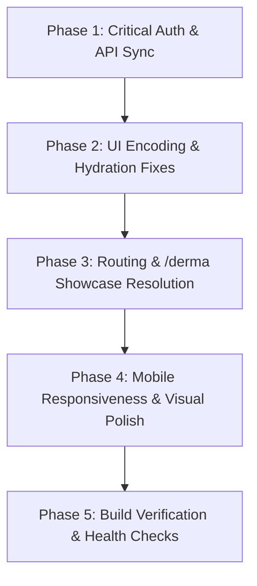

# MedNexa Frontend Remediation & UI Polish Plan

> **Scope**: `scratch/mednexa-repo` (`https://github.com/mhd-shereef/MedNexa`)  
> **Ecosystem Context**: Synchronizing with `DERMA-ai` EMR (`https://github.com/mhd-shereef/Derma`)  
> **Status**: Ready for Execution

---

## 1. Objectives & Overview

This plan outlines the systematic fix and enhancement of the **MedNexa Health Ecosystem** frontend (`scratch/mednexa-repo`). It resolves:
1. **Critical Authentication & Backend Communication Bugs** preventing login and kicking users out of the dashboard.
2. **Visual & Encoding Mistakes** (mojibake corruption, layout shifts from SSR hydration mismatch, clipping text).
3. **Broken Routing** (infinite loop on `/derma`).
4. **Ecosystem Branding Inconsistencies** across auth and dashboard views.

---

## 2. Phase-by-Phase Execution Plan



---

### Phase 1: Critical Authentication & API Synchronization
*Ensure that MedNexa seamlessly talks to the production Render backend and authenticates successfully.*

- [ ] **1.1. Synchronize API Client Fallback**
  - **File**: `scratch/mednexa-repo/src/lib/api-client.ts`
  - **Change**: Implement dynamic base URL detection:
    ```typescript
    const getBaseApiUrl = (): string => {
      const envUrl = process.env.NEXT_PUBLIC_API_URL;
      if (typeof window !== 'undefined' && !window.location.hostname.includes('localhost')) {
        if (!envUrl || envUrl.includes('localhost')) {
          return 'https://derma-xmpq.onrender.com/api/v1';
        }
      }
      return envUrl || 'http://localhost:3001/api/v1';
    };
    ```
- [ ] **1.2. Fix Response Data Unpacking in Login**
  - **File**: `scratch/mednexa-repo/src/app/(auth)/login/page.tsx`
  - **Change**: Unpack both `response.data` and nested `response.data.data` from NestJS envelopes:
    ```typescript
    const payload: any = response.data;
    const authData = payload?.data ?? payload;
    const { user, accessToken, refreshToken } = authData;
    ```
- [ ] **1.3. Replace Client Router Push with Hard Navigation on Login**
  - **File**: `scratch/mednexa-repo/src/app/(auth)/login/page.tsx`
  - **Change**: Use `window.location.href = '/dashboard'` to guarantee clean cookie, localStorage, and Zustand store hydration.
- [ ] **1.4. Fix Dashboard Layout Auth Guard**
  - **File**: `scratch/mednexa-repo/src/app/(dashboard)/layout.tsx`
  - **Change**: Safely unpack user in `/auth/me` check:
    ```typescript
    const payload: any = response.data;
    const userData = payload?.data?.user ?? payload?.user;
    ```

---

### Phase 2: UI Encoding Sanitization & SSR Hydration
*Eliminate all mojibake/corrupted characters and prevent jarring Cumulative Layout Shift (CLS).*

- [ ] **2.1. Sanitize Mangled Special Characters**
  - **File**: `scratch/mednexa-repo/src/app/page.tsx`
  - **Replacements**:
    - `ΓÇö` $\rightarrow$ `—` (em-dash)
    - `┬·` $\rightarrow$ `·` (middle dot)
    - `Γåù` $\rightarrow$ `↗` (north-east arrow)
    - `ΓåÆ` $\rightarrow$ `→` (right arrow)
    - `┬⌐` $\rightarrow$ `©` (copyright)
    - `ΓÇó` $\rightarrow$ `•` (bullet)
- [ ] **2.2. Eliminate SSR Hydration Flicker in Navigation Components**
  - **Files**:
    - `scratch/mednexa-repo/src/components/ui/Header.tsx`
    - `scratch/mednexa-repo/src/components/ui/Sidebar.tsx`
  - **Change**: Remove premature `if (typeof window === 'undefined') return null;`. Replace with a standard `isMounted` hook or render SSR-safe skeletons/placeholders to avoid blank initial frames and layout shifts.

---

### Phase 3: Routing & `/derma` Showcase Resolution
*Eliminate dead loops and build a meaningful experience for visitors exploring DERMA.*

- [ ] **3.1. Re-implement `/derma` Route**
  - **File**: `scratch/mednexa-repo/src/app/derma/page.tsx`
  - **Current**: Returns `<LandingPage />` (infinite loop back to home).
  - **Target**: Create a focused DERMA product spotlight page showcasing:
    1. Physician-grade dermatology documentation overview.
    2. The 4 Clinical Modules (Pre-Op Protocol, Tissue Exam, Polarized Dermoscopy, Laser Parameter Registry).
    3. Direct CTA buttons: **"Launch Live Clinical DEMO"** (links to `/login` with auto-fill credentials) and **"Back to Ecosystem"** (links to `/`).
- [ ] **3.2. Clean Dropdown Navigation Behaviors**
  - **File**: `scratch/mednexa-repo/src/app/page.tsx`
  - **Change**: Ensure both hover and keyboard/tap interactions toggle the Products menu reliably without getting stuck open or closed.

---

### Phase 4: Mobile Responsiveness & Ecosystem Branding
*Ensure flawless rendering across viewports and unified ecosystem branding.*

- [ ] **4.1. Refactor Clinical Modules Thumbnail Strip**
  - **File**: `scratch/mednexa-repo/src/app/page.tsx`
  - **Change**: Change from rigid `grid-cols-4` to responsive `grid-cols-2 sm:grid-cols-4` with adjusted padding and legible typography so text never overflows or overlaps image gradients on screens < 380px.
- [ ] **4.2. Align Ecosystem Branding on Authentication Page**
  - **File**: `scratch/mednexa-repo/src/app/(auth)/login/page.tsx`
  - **Change**: Include the **MedNexa** parent ecosystem badge above the **DERMA** clinical header:
    - `"MedNexa Clinical Ecosystem • DERMA Physician OS"`
    - Adds context for users entering via the MedNexa portal.

---

### Phase 5: Verification & Build Validation
*Confirm zero compile errors, zero runtime exceptions, and smooth navigation.*

- [ ] **5.1. TypeScript & Lint Checks**
  - Run `npm run type-check` / `npm run build` in `scratch/mednexa-repo`.
- [ ] **5.2. Functional Smoke Tests**
  - Verify landing page renders without broken Unicode characters.
  - Test `/derma` navigation link.
  - Test demo login flow connecting to Render backend (`https://derma-xmpq.onrender.com/api/v1`).
  - Verify `/dashboard` session persistence after login.

---

## 3. Success Metrics
- **Zero Mojibake**: No `Γ` or `┬` symbols in any rendered file.
- **Flawless Auth**: Successful 1-click demo login leading straight to `/dashboard`.
- **Zero Dead Ends**: `/derma` provides a dedicated clinical EMR walkthrough.
- **Clean Build**: `npm run build` exits with code 0.
